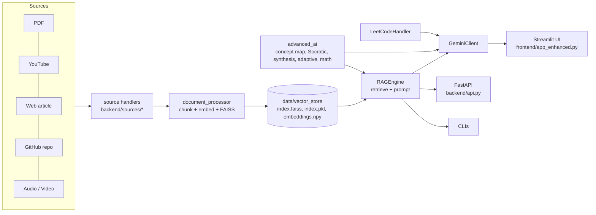

# AI Study Mentor

> A domain-specific **Retrieval-Augmented Generation (RAG)** tutor for Computer Science learning, built with Python, Streamlit, FastAPI, sentence-transformers, FAISS and Google Gemini.

AI Study Mentor was my first project for learning AI engineering, and it grew into a hackathon-style demo. You feed it study material (textbook PDFs, YouTube lectures, web articles, GitHub repos, audio recordings). It chunks and indexes that material, then answers questions **only from your sources, with citations**. On top of Q&A it adds tutoring tools (concept maps, a Socratic tutor, adaptive explanations, math solving) and a searchable LeetCode problem bank with AI-generated study guides.

---

## Table of Contents

1. [Features](#features)
2. [How it works](#how-it-works)
3. [Architecture](#architecture)
4. [Repository layout](#repository-layout)
5. [Tech stack](#tech-stack)
6. [Getting started](#getting-started)
7. [Configuration](#configuration)
8. [Adding study material](#adding-study-material)
9. [Running the app](#running-the-app)
10. [Using the UI](#using-the-ui)
11. [REST API](#rest-api)
12. [Command-line tools](#command-line-tools)
13. [Core concepts and internals](#core-concepts-and-internals)
14. [LeetCode module](#leetcode-module)
15. [Datasets and data directory](#datasets-and-data-directory)
16. [Demo mode](#demo-mode)
17. [Documentation in this repo](#documentation-in-this-repo)
18. [Project history and status](#project-history-and-status)
19. [Known limitations](#known-limitations)
20. [Roadmap](#roadmap)
21. [License](#license)

---

## Features

### Core RAG
- **Multi-source ingestion**: PDFs, YouTube transcripts, web articles, GitHub repos (READMEs, docs and Python docstrings/comments), and audio/video files transcribed with Whisper.
- **Semantic retrieval** with `sentence-transformers/all-MiniLM-L6-v2` embeddings (384-d, normalized, cosine similarity), with an automatic **keyword-overlap (Jaccard) fallback** when ML libraries are unavailable.
- **Grounded answers**: prompts instruct Gemini to use only the retrieved context and cite sources (document name and page, or video timestamp).
- **Four study modes** that change the prompt style: *ELI5*, *Technical*, *Interview Prep*, *Quick Summary*.
- **Visual RAG**: retrieved chunks are shown as cards with relevance scores (green/amber/red) and highlighted query keywords.

### Tutoring tools (Gemini-powered, each with an offline fallback)
| Tool | What it does |
|---|---|
| **Concept Map** | Generates a `{nodes, edges}` graph for a topic, rendered with Graphviz. Export as JSON or DOT. |
| **Socratic Tutor** | Returns 3–5 guiding questions plus a 3-step hint ladder without revealing the answer. |
| **Multi-Document Synthesis** | Compares how each document explains a topic and returns similarities, conflicts, a unified synthesis and citations. |
| **Adaptive Tutor** | Explains a question at one of five levels (ELI5, ELI10, Undergrad, Grad, Expert) and ends with 3 quiz questions. |
| **Math** | Symbolic simplify, differentiate, integrate and solve via SymPy, with LaTeX output and short steps. |
| **3D Viz** | Interactive Plotly 3D scatter of chunks, coloured by document (see [limitations](#known-limitations)). |
| **Analytics** | Per-session dashboard: queries, average similarity, latency, token estimates, document usage, streak. Export a Markdown study report or CSV. |

### LeetCode Practice + Mentor
- Unified loader for three public LeetCode datasets (HuggingFace + two Kaggle), normalized into one JSONL file.
- Semantic (or keyword) search with difficulty and topic filters.
- One-click AI study guide: key observations, step-by-step approach, complexity, pitfalls, progressive hints, and a clean Python solution.

### Study aids and export
These live in the earlier UI (`frontend/app.py`); the backend functions are also available to any client.
- **Query suggestions** generated from your own corpus.
- **Chat → study notes** summarizer (Markdown), with PDF (via ReportLab) and HTML export.
- **Flashcards** export (CSV).
- **Chat export** (Markdown).

### Engineering extras
- **FastAPI backend** with Swagger/ReDoc docs, CORS, request logging, a simple in-memory rate limiter (60 requests/min/IP), and optional Server-Sent-Events streaming.
- **Resilient Gemini client**: auto-resolves a model that supports `generateContent`, retries transient errors (503/timeout/rate-limit) with backoff, and falls back to `gemini-flash-latest`.
- **Local caching**: `embeddings.npy` and vector-store files are cached so the app starts instantly after preprocessing.
- **Demo Mode**: an instant, canned-response experience that needs no API key or index.
- **Polished UI**: animated gradient theme, glassmorphism cards, a Cmd/Ctrl+K command palette, toasts and confetti.

---

## How it works

```
 Sources (PDF / YouTube / Web / GitHub / Audio)
        │  extract text per source type
        ▼
 Chunking (800 chars, 160 overlap)  ──►  chunk dicts {text, doc, page, chunk_id, source_type, url, extra}
        │
        ▼
 Embeddings (all-MiniLM-L6-v2, normalized, cached to embeddings.npy)
        │
        ▼
 Vector store (FAISS IndexFlatIP + index.pkl metadata)
        │                                   ┌── keyword Jaccard fallback if no embeddings
 Query ─► embed ─► cosine top-k  ◄──────────┘
        │
        ▼
 Prompt builder (mode: default / eli5 / technical / interview / summary)
        │
        ▼
 Gemini (google-generativeai)  ──►  answer + citations  ──►  Streamlit UI / FastAPI / CLI
```

1. **Ingest**: each input is routed to a source handler by type (see [Core concepts](#core-concepts-and-internals)).
2. **Chunk**: text is split into ~800-character windows with 160 characters of overlap so sentences survive chunk boundaries.
3. **Embed**: chunks are encoded in batches (32, falling back to 8) and L2-normalized, so the dot product equals cosine similarity.
4. **Retrieve**: the query is embedded the same way, and the top-k chunks (default 3) are returned with scores.
5. **Prompt**: chunks are formatted as `- [doc (page N)] text` and inserted into a mode-specific template.
6. **Generate**: Gemini produces the answer. If generation fails, the UI still shows the retrieved context and prompt.

---

## Architecture



**Design principles**
- **Graceful degradation everywhere**: optional imports are wrapped in `try/except`, so a missing library disables a feature rather than crashing the app. This was added after segfaults from PyTorch/Accelerate on macOS.
- **Lazy loading**: `sentence-transformers` is imported only when embeddings are actually needed.
- **Pluggable sources**: every source implements the `BaseSource` interface (`validate`, `extract`, `get_metadata`) and returns the same chunk schema.
- **Cloud inference only**: Gemini is the supported LLM. An older Ollama client remains in the repo (see [limitations](#known-limitations)).

---

## Repository layout

```
AI-study-mentor-/
├── backend/
│   ├── api.py                  # FastAPI app (upload, documents, stats, search, query + SSE)
│   ├── rag_engine.py           # RAGEngine: load store, retrieve, prompt modes, Gemini answers, suggestions, notes, synthesis
│   ├── document_processor.py   # PDF reading, chunking, source routing, embeddings, FAISS build/load
│   ├── llm_config.py           # GeminiClient: model resolution, retry/backoff, fallback
│   ├── llm_ollama.py           # OllamaClient (legacy local-LLM path)
│   ├── advanced_ai.py          # Concept map, Socratic tutor, multi-doc synthesis, adaptive explain, math solver
│   ├── leetcode_handler.py     # LeetCodeHandler: load/normalize/search/explain LeetCode problems
│   ├── export_utils.py         # Markdown → PDF (ReportLab) and Markdown → HTML
│   ├── source_manager.py       # detect_source_type / get_handler / process_url / process_file
│   └── sources/
│       ├── base_source.py      # BaseSource ABC + shared chunk_text()
│       ├── youtube_source.py   # Transcript + oEmbed metadata, timestamped citation URLs
│       ├── web_source.py       # requests + readability-lxml + BeautifulSoup
│       ├── github_source.py    # README via API, else clone; .md/.rst/.txt/.py
│       └── audio_source.py     # OpenAI Whisper transcription with segment timestamps
├── frontend/
│   ├── app_enhanced.py         # Main Streamlit app (9 tabs, sidebar settings, source management)
│   ├── app.py                  # Earlier Streamlit hackathon UI (sidebar + Ask/Map/LeetCode/Analytics)
│   ├── demo_app.py             # Standalone canned-response demo
│   ├── demo_module.py          # Demo UI embedded into the main app's Demo Mode
│   ├── components.py           # CSS/JS injection, Lottie helper, shortcut hint
│   ├── pages/00_Hero.py        # Landing/hero page
│   ├── static/{style.css,app.js}   # Glassmorphism theme, command palette, toast, confetti
│   └── styles.css              # Extra dark theme (cards, badges, pipeline)
├── scripts/
│   ├── preprocess_all_documents.py  # Build the vector store once for fast startup
│   └── prepare_leetcode_data.py     # Download/normalize LeetCode datasets
├── data/
│   ├── uploaded_files/         # PDFs, audio, and sources.txt (URLs)
│   └── leetcode/               # Kaggle CSVs + normalized_problems.jsonl
├── docs/
│   ├── LEARNING_GUIDE.md       # Step-by-step RAG tutorial using this codebase
│   ├── demo_guide.md           # 3-minute demo script
│   └── ARCHITECTURE.md         # (placeholder, currently empty)
├── tests/test_rag_pipeline.py  # (placeholder, currently empty)
├── chat_cli.py                 # Interactive retrieval CLI (semantic with keyword fallback)
├── keyword_cli.py              # Retrieval CLI using keyword overlap only
├── ollama_cli.py               # Ollama-based CLI
├── test_real_pdf.py            # Quick PDF text-extraction smoke test
├── Emergency Hackathon Context.md  # Hackathon-day planning notes and pitch
├── requirements.txt
├── .env.example
└── LICENSE (MIT)
```

---

## Tech stack

| Area | Tools |
|---|---|
| Language | Python 3.10+ (uses `X \| None` type syntax) |
| UI | Streamlit, Plotly, Graphviz (via `st.graphviz_chart`), custom CSS/JS |
| API | FastAPI, Uvicorn, Pydantic, python-multipart |
| LLM | Google Gemini (`google-generativeai`), default model `gemini-flash-latest` |
| Embeddings | `sentence-transformers` (`all-MiniLM-L6-v2`) |
| Vector search | FAISS (`faiss-cpu`) and NumPy cosine similarity |
| Ingestion | `pypdf`, `youtube-transcript-api`, `requests`, `beautifulsoup4`, `readability-lxml`, `gitpython`, `openai` (Whisper) |
| Math | SymPy |
| ML utils | scikit-learn (t-SNE/PCA for the 3D view) |
| Export | ReportLab (PDF), `markdown` (HTML), `genanki` (listed dependency) |
| Datasets | HuggingFace Hub, Kaggle API, pandas |

---

## Getting started

### Prerequisites
- Python 3.10 or newer
- A **Gemini API key** from Google AI Studio (needed for generated answers and the tutoring tools)
- Optional: an **OpenAI API key** (only for audio/video transcription)
- Optional: Kaggle credentials at `~/.kaggle/kaggle.json` (only to download LeetCode datasets; a normalized copy is already in the repo)

### Install

```bash
git clone https://github.com/moh0405/AI-study-mentor-.git
cd AI-study-mentor-

python -m venv .venv
source .venv/bin/activate          # Windows: .venv\Scripts\activate

pip install -r requirements.txt
```

`requirements.txt` does not currently list every optional dependency. If a feature reports a missing package, install what it names. These are the ones used by code in this repo that are **not** pinned:

```bash
pip install pandas numpy huggingface_hub kaggle reportlab markdown matplotlib
```

### Configure

```bash
cp .env.example .env
# then edit .env and set GEMINI_API_KEY
```

---

## Configuration

Environment variables (loaded from `.env` via `python-dotenv`):

| Variable | Required | Default | Purpose |
|---|---|---|---|
| `GEMINI_API_KEY` | Yes, for generation | none | Google Gemini API key |
| `GEMINI_MODEL` | No | `gemini-flash-latest` | Preferred model. The client verifies it supports `generateContent` and falls back automatically. |
| `GEMINI_TEMPERATURE` | No | `0.2` | Default sampling temperature |
| `OPENAI_API_KEY` | Only for audio | none | Whisper transcription of `.mp3/.mp4/.wav/.m4a` (read by the audio source, not listed in `.env.example`) |
| `OLLAMA_MODEL` | No | `llama3` | Model for the legacy Ollama client |

Never commit `.env`. It is already in `.gitignore`.

---

## Adding study material

Everything lives under `data/uploaded_files/`.

| Type | How to add it |
|---|---|
| **PDF** | Drop `.pdf` files into `data/uploaded_files/`, or use the sidebar uploader / `POST /api/upload`. |
| **Audio / video** | Drop `.mp3`, `.mp4`, `.wav` or `.m4a` into the folder, or use the sidebar "Upload audio" expander. Requires `OPENAI_API_KEY`. |
| **URLs** | Add one URL per line to `data/uploaded_files/sources.txt` (or edit it in the sidebar "Add URLs" expander). Supported: YouTube videos, GitHub repos, and generic web articles. |

The repo ships with:
- 3 PDFs: *Data Structures Using Python*, *Dsa*, *Introduction to Computer Science*
- `sources.txt` pointing to a YouTube lecture, the Python tutorial, and several algorithm repos (`pypa/sampleproject`, `dsc-iem/TheAlgorithms`, `akshitagit/Python`, `mitcc/AlgoSolutions`, `alfaarghya/alfa-leetcode-api`) plus a YouTube playlist link.

### Build the index (recommended)

```bash
python scripts/preprocess_all_documents.py
```

This scans `data/uploaded_files/` and writes `data/vector_store/`:

- `index.faiss`: FAISS inner-product index
- `index.pkl`: chunk metadata
- `embeddings.npy`: normalized embeddings used for fast NumPy retrieval

Without a prebuilt store, the engine falls back to scanning **local files only** (PDFs and audio) at startup and uses keyword retrieval. That works but is slower and less accurate.

You can also run the module directly: `python -m backend.document_processor` (skips the rebuild if the store already exists).

---

## Running the app

### Streamlit UI (main experience)

```bash
streamlit run frontend/app_enhanced.py
```

The earlier hackathon UI is also available:

```bash
streamlit run frontend/app.py --server.port=8504
```

A standalone canned-response demo that needs no API key:

```bash
streamlit run frontend/demo_app.py
```

### FastAPI backend

```bash
uvicorn backend.api:app --reload --port 8000
```

Interactive docs: <http://localhost:8000/docs> (Swagger) and <http://localhost:8000/redoc>.

---

## Using the UI

### Sidebar (`app_enhanced.py`)
- **Demo Mode** toggle: instant canned experience; "Switch back to Normal Mode" to return.
- **Settings**: Top-k context chunks (1–8), temperature (0.0–1.0), model (optionally load the supported-model list from the API), *Generate answers (Gemini)* (turn off for retrieval-only), *Show final prompt*.
- **Document Stats**: documents, chunks and page range, with a **Refresh stats** button after adding sources.
- **Demo Warm-Up**: pre-runs popular queries to fill caches.
- **Add Sources**: save URLs to `sources.txt`, upload audio files.

### Tabs

| Tab | Usage |
|---|---|
| **Ask** | Type a question or click an example. See retrieved context cards with scores and highlights, the generated answer, and optionally the prompt. (Chat export, study notes and flashcards are in the older `frontend/app.py`.) |
| **Concept Map** | Enter a topic and click *Generate Concept Map*. Inspect individual concepts and download JSON or DOT. |
| **Socratic Tutor** | Ask a question and click *Guide me* for guiding questions and a hint ladder. |
| **Synthesis** | Enter a topic and click *Compare & Synthesize* to compare how your documents explain it. |
| **Adaptive Tutor** | Pick a level (ELI5 → Expert), ask a question, and get a tailored explanation plus a mini quiz. |
| **Math** | Prompts such as `differentiate sin(x)`, `integrate x^2`, `simplify (x^2 + 2x + 1)`, `solve x^2 = 4 for x`. |
| **3D Viz** | Rotate and zoom a 3D scatter of up to 500 chunks. |
| **LeetCode** | Load the dataset, search with filters, and generate a mentor-style study guide for a chosen problem. |
| **Analytics** | Session metrics and charts; download a Markdown study report or a CSV. |

### Keyboard shortcuts
- `Cmd/Ctrl + K`: open the command palette
- `Cmd/Ctrl + /`: toggle the sidebar

### Study modes (Ask tab / `RAGEngine`)
| Mode | Output style |
|---|---|
| default | Concise answer from context only, cites sources |
| `eli5` | Short sentences, no jargon, a friendly analogy, one-sentence recap |
| `technical` | Precise definitions, complexity, code/pseudocode if in context, trade-offs, edge cases |
| `interview` | 2-sentence overview, bullets for approach/complexity/edge cases, pitfalls, short example |
| `summary` | 5–8 one-sentence bullets, no speculation |

---

## REST API

Base URL: `http://localhost:8000`. All endpoints except the docs pages are rate-limited to **60 requests/minute per IP** (HTTP 429 when exceeded).

| Method | Path | Description |
|---|---|---|
| `GET` | `/health` | Liveness check. Returns `{"status": "ok", "uptime_sec": ...}`. |
| `POST` | `/api/upload` | Upload one or more PDFs (`multipart/form-data`, field `files`). Only `.pdf` is accepted. Returns per-file results. |
| `GET` | `/api/documents` | List the unique document names found in the corpus. |
| `DELETE` | `/api/documents/{doc}` | Delete an uploaded file by name. Does not rebuild the index. |
| `GET` | `/api/stats` | Document count, chunk count, min/max page. |
| `GET` | `/api/search?query=...&k=5` | Retrieval only: top-k chunks with scores. |
| `POST` | `/api/query` | RAG query. Body: `{question, k=3, model?, temperature=0.2, stream=false}`. Returns `{prompt, chunks, answer, ok, model, error}`. With `stream=true`, returns `text/event-stream` with `meta`, `token`, and `done` events. |

Example:

```bash
curl -X POST http://localhost:8000/api/query \
  -H "Content-Type: application/json" \
  -d '{"question": "What is a linked list?", "k": 3}'
```

Validation: `question` must be at least 3 characters, `k` is 1–20, and `temperature` is 0.0–1.0.

---

## Command-line tools

| Command | Description |
|---|---|
| `python chat_cli.py` | Interactive loop: prints retrieved context and the final prompt for each question. Uses semantic retrieval with a keyword fallback. |
| `python keyword_cli.py` | Pure keyword-overlap retrieval (no ML libraries). Reads a LangChain-style `index.pkl`. |
| `python ollama_cli.py` | Ollama-based CLI (legacy path). |
| `python test_real_pdf.py` | Extracts and previews text from `data/uploaded_files/Dsa.pdf` to check PDF parsing. |
| `python scripts/preprocess_all_documents.py` | Build the vector store. |
| `python scripts/prepare_leetcode_data.py` | Download and normalize LeetCode datasets. |
| `python -m backend.rag_engine` | Prints a sample prompt and top chunks for "What is a linked list?". |
| `python -m backend.leetcode_handler` | Loads the problem set, prints stats, and runs a sample search. |

---

## Core concepts and internals

### Source handlers (`backend/sources/`)
All handlers extend `BaseSource` and return chunks in this schema:

```python
{
  "text": str,            # chunk content
  "doc": str,             # human-friendly document label
  "page": int | None,     # page number (PDFs) or None
  "chunk_id": str,        # unique id
  "source_type": str,     # "pdf" | "youtube" | "web" | "github" | "audio"
  "url": str | None,      # canonical URL for citation
  "extra": dict,          # e.g. timestamps, citation_url, file_path
}
```

| Handler | Behaviour |
|---|---|
| **PDF** (`document_processor.py`) | Extracts text per page with `pypdf`, chunks each page, records page numbers. |
| **YouTubeSource** | Fetches the transcript with timestamps, merges segments into ~800-character chunks, fetches title/thumbnail via oEmbed, and builds timestamped citation URLs (`...watch?v=ID&t=NNs`). |
| **WebSource** | Downloads the page, extracts the article body with `readability-lxml`, keeps code blocks in fenced backticks, and records a favicon. |
| **GitHubSource** | Tries the GitHub API for the README first; otherwise clones into `data/repos/`. Indexes `.md`, `.rst`, `.txt` and `.py` (for Python it keeps comments and docstrings only). |
| **AudioSource** | Transcribes with OpenAI Whisper (`verbose_json` for timestamps, plain-text fallback), then chunks by segment. |

Source type is detected in `document_processor._detect_source` (and `source_manager.detect_source_type`): local `.pdf` → PDF, local audio extensions → audio, `youtube.com`/`youtu.be` → YouTube, `github.com` → GitHub, other `http(s)` → web.

### `RAGEngine` (`backend/rag_engine.py`)
- `retrieve_context(query, k)`: cosine similarity over cached embeddings, or Jaccard keyword overlap if embeddings are unavailable.
- `generate_prompt(question, chunks, mode)`: builds the mode-specific prompt.
- `answer_with_gemini(...)`: retrieve → prompt → Gemini. `generate_answer(...)` synthesizes from caller-supplied context.
- `generate_query_suggestions(...)`: proposes study questions from the corpus (static fallback list on failure).
- `summarize_chat(history)`: turns the last 20 Q&A turns into Markdown study notes (heuristic fallback).
- `multi_source_synthesis(question)`: top chunks per document, then Gemini compares and cites.
- Accepts both LangChain-style (`(docstore, index_to_id)`) and this project's `{"metadata": [...]}` pickle formats.

### `GeminiClient` (`backend/llm_config.py`)
1. Reads `GEMINI_API_KEY`, `GEMINI_MODEL`, `GEMINI_TEMPERATURE`.
2. `_resolve_model`: uses the requested model if it supports `generateContent`; otherwise tries `gemini-flash-latest`, `gemini-pro-latest`, then `1.5` variants, then the first supported model.
3. `generate`: tries the chosen model, then `gemini-flash-latest`. Each model gets up to 2 attempts, with backoff on 503, timeout and rate-limit errors. Non-compatibility errors (auth, network) stop the chain early.

### Advanced AI (`backend/advanced_ai.py`)
- `build_concept_map` and `concept_map_to_dot`: JSON graph from Gemini; falls back to a keyword-frequency chain.
- `socratic_tutor`: questions and hints as JSON; canned questions as fallback.
- `multi_document_synthesis`: similarities, conflicts, synthesis and citations as JSON.
- `adaptive_explain`: five `ELI_LEVELS` plus a 3-question quiz.
- `math_solve`: SymPy-backed `simplify`, `differentiate`/`derivative`, `integrate`, `solve ... for ...`, or plain LaTeX rendering.

### Exports (`backend/export_utils.py`)
`markdown_to_pdf` (ReportLab, headings/bullets/simple wrapping, returns `None` if ReportLab is missing) and `markdown_to_html` (uses `markdown` if installed, otherwise a small built-in converter).

---

## LeetCode module

`LeetCodeHandler` (`backend/leetcode_handler.py`) merges several datasets into one searchable bank.

**Sources (best effort, each with a graceful fallback)**
1. HuggingFace: `kaysss/leetcode-problem-set`
2. Kaggle: `gzipchrist/leetcode-problem-dataset`
3. Kaggle: `mohitkumar282/leetcode-questions-dataset`
4. Any local CSV/JSON/JSONL under `data/leetcode/`

**Pipeline**
- Reads `data/leetcode/normalized_problems.jsonl` first (fast path). If it's missing, downloads or parses the raw sources and writes it.
- Normalizes many column-name variants (`id`/`question_id`/`slug`, `tags`/`topic_tags`, `content`/`body`, and so on) into an `LCProblem` (`pid`, `title`, `difficulty`, `topics`, `description`, `url`, `acceptance`, `likes`, `dislikes`, `source`).
- De-duplicates by lower-cased title and merges metadata from duplicates.
- Optionally embeds `title + description` into `data/leetcode/embeddings.npy`.

**API**
- `load_all(force=False, generate_embeddings=True)` → `(count, status)`
- `search(query, top_k=10, difficulty=[...], topics=[...])`
- `explain_problem(pid)` → Markdown study guide
- `get_stats()` → totals, by-difficulty counts, top topics
- `get_by_id(pid)`

`scripts/prepare_leetcode_data.py` runs the loader with embeddings disabled (to avoid macOS segfaults), so search uses keyword scoring unless embeddings already exist.

---

## Datasets and data directory

| Path | Contents |
|---|---|
| `data/uploaded_files/` | 3 CS textbook PDFs and `sources.txt` (about 56 MB total) |
| `data/leetcode/kaggle/` | Three raw Kaggle CSVs |
| `data/leetcode/normalized_problems.jsonl` | 1,825 normalized problems |
| `data/vector_store/` | *Generated.* FAISS index, metadata pickle, embeddings |
| `data/repos/` | *Generated.* Cloned GitHub repos used as sources |

---

## Demo mode

For presentations (and as a backup if the network or API fails):
- **Demo Mode checkbox** in the main app's sidebar switches to a cached experience (`frontend/demo_module.py`).
- **`frontend/demo_app.py`** runs standalone with canned answers for *Explain dynamic programming*, *What is a hash table?* and *Solve Two Sum*, plus Ask, LeetCode, Analytics and About tabs.
- **`docs/demo_guide.md`** has a 3-minute script: stats → LeetCode search → multi-source answer → analytics.
- **`Emergency Hackathon Context.md`** holds the planning notes, timeline, checklist and pitch from the hackathon day.

---

## Documentation in this repo

- [`docs/LEARNING_GUIDE.md`](docs/LEARNING_GUIDE.md): a step-by-step RAG tutorial that maps each concept (ingestion, chunking, embeddings, vector stores, retrieval, prompting, LLM integration, evaluation) to code in this repository.
- [`docs/demo_guide.md`](docs/demo_guide.md): the demo script.
- [`docs/ARCHITECTURE.md`](docs/ARCHITECTURE.md): placeholder (empty). The architecture is documented above.

---

## Project history and status

- **Origin**: the first AI-engineering project, started in October 2025 to learn RAG with LangChain, ChromaDB/FAISS and LLMs on CS material.
- **Nov 2025**: pipeline working end to end without a UI, caching and preprocessing for fast startup, custom CSS, demo mode, batch-processing optimizations. Built under a hackathon deadline (see the context file).
- **Jan 2026**: added transient retry logic to the Gemini client and re-applied the Demo Mode refactor.
- **Open work**: [PR #1](https://github.com/moh0405/AI-study-mentor-/pull/1), "Add document processing pipeline with FAISS" (branch `feature/document-processing`, still open).

---

## Known limitations

Documented honestly so you know what to expect. These come from reading the code, not from a test run.

- **Tests are empty**: `tests/test_rag_pipeline.py` has no content, and there is no CI.
- **Dependencies are incomplete**: several libraries the code imports (pandas, huggingface_hub, kaggle, reportlab, markdown, matplotlib, numpy) are not in `requirements.txt`. The file says Ollama support was removed, but `llm_ollama.py`, `ollama_cli.py` and `RAGEngine.answer_with_ollama` still exist and need `langchain-ollama`. `langchain` is pinned but not used by the core pipeline.
- **FAISS is built but not queried**: `RAGEngine` loads `index.faiss` but retrieval is done with NumPy over `embeddings.npy`.
- **Keyword fallback scores**: in `retrieve_context`, every result in the keyword path reports the top result's score rather than its own.
- **3D Viz is not semantic**: points are projected from SHA-256 hashes of the text (chosen to avoid macOS segfaults), so distances do not reflect meaning.
- **Fake streaming**: `/api/query?stream=true` generates the full answer first, then replays it word by word.
- **Query modes in the API**: the study `mode` is not exposed on `/api/query`.
- **Performance**: the API creates a new `RAGEngine` per request. Without a prebuilt vector store, that re-parses every local PDF each time.
- **Security (demo-grade)**:
  - CORS allows all origins and the rate limiter is in-memory per process.
  - Uploaded filenames are used as-is, so path-traversal sequences in a filename are not rejected.
  - The vector store metadata is loaded with `pickle`, so only load stores you built yourself.
  - The math tool passes user input to SymPy's `sympify`, which evaluates expressions, so do not expose it to untrusted users.
- **Committed artifacts**: `.DS_Store` files and about 56 MB of PDFs are tracked in git.
- **Source quirks**: YouTube playlist URLs (as in the sample `sources.txt`) have no `v=` video id and are skipped. Python files from GitHub repos are indexed as comments/docstrings only, not code.
- **Stale hackathon numbers**: figures like "977 docs / 12K chunks" and "2000+ problems" in the demo script and context file describe the hackathon corpus. The shipped LeetCode file has 1,825 problems.

---

## Roadmap

- Finish the FAISS document-processing pipeline (PR #1) and use the FAISS index for retrieval
- Add real tests (chunking, retrieval, prompt modes, API) and CI
- Complete `requirements.txt` and add a Dockerfile
- Real token streaming from Gemini, and expose study modes in the API
- Persistent index updates on upload/delete
- Use real embeddings for the 3D view
- Hardening: filename sanitization, safe metadata format instead of pickle, restricted CORS, sandboxed math
- Remove committed binaries from history (Git LFS or download scripts) and fill in `docs/ARCHITECTURE.md`

---

## License

Released under the [MIT License](LICENSE). Copyright (c) 2025 moh0405.
