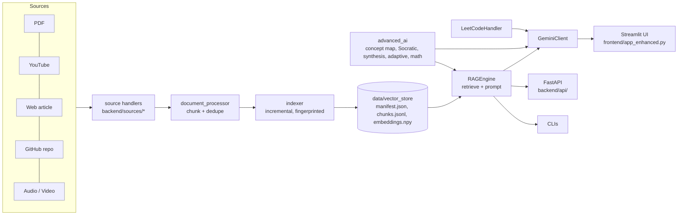

# AI Study Mentor

> A domain-specific **Retrieval-Augmented Generation (RAG)** tutor for Computer Science learning, built with Python, Streamlit, FastAPI, sentence-transformers, FAISS and Google Gemini.

AI Study Mentor was my first project for learning AI engineering, and it grew into a hackathon-style demo. You feed it study material (textbook PDFs, YouTube lectures, web articles, GitHub repos, audio recordings). It chunks and indexes that material, then answers questions **only from your sources, with citations**. On top of Q&A it adds tutoring tools (concept maps, a Socratic tutor, adaptive explanations, math solving) and a searchable LeetCode problem bank with AI-generated study guides.

---

## Table of Contents

1. [Features](#features)
2. [How it works](#how-it-works)
3. [Architecture](#architecture)
4. [Repository layout](#repository-layout)
5. [Tech stack](#tech-stack)
6. [Getting started](#getting-started)
7. [Configuration](#configuration)
8. [Adding study material](#adding-study-material)
9. [Running the app](#running-the-app)
10. [Using the UI](#using-the-ui)
11. [REST API](#rest-api)
12. [Command-line tools](#command-line-tools)
13. [Core concepts and internals](#core-concepts-and-internals)
14. [LeetCode module](#leetcode-module)
15. [Datasets and data directory](#datasets-and-data-directory)
16. [Demo mode](#demo-mode)
17. [Documentation in this repo](#documentation-in-this-repo)
18. [Project history and status](#project-history-and-status)
19. [Known limitations](#known-limitations)
20. [Roadmap](#roadmap)
21. [License](#license)

---

## Features

### Core RAG
- **Multi-source ingestion**: PDFs, YouTube transcripts, web articles, GitHub repos (READMEs, docs and Python docstrings/comments), and audio/video files transcribed with Whisper.
- **Semantic retrieval** with `sentence-transformers/all-MiniLM-L6-v2` embeddings (384-d, normalized, cosine similarity), with an automatic **keyword-coverage fallback** when ML libraries are unavailable.
- **Grounded answers**: prompts instruct Gemini to use only the retrieved context and cite sources (document name and page, or video timestamp).
- **Four study modes** that change the prompt style: *ELI5*, *Technical*, *Interview Prep*, *Quick Summary*.
- **Visual RAG**: retrieved chunks are shown as cards with relevance scores (green/amber/red) and highlighted query keywords.

### Tutoring tools (Gemini-powered, each with an offline fallback)
| Tool | What it does |
|---|---|
| **Concept Map** | Generates a `{nodes, edges}` graph for a topic, rendered with Graphviz. Export as JSON or DOT. |
| **Socratic Tutor** | Returns 3–5 guiding questions plus a 3-step hint ladder without revealing the answer. |
| **Multi-Document Synthesis** | Compares how each document explains a topic and returns similarities, conflicts, a unified synthesis and citations. |
| **Adaptive Tutor** | Explains a question at one of five levels (ELI5, ELI10, Undergrad, Grad, Expert) and ends with 3 quiz questions. |
| **Math** | Symbolic simplify, differentiate, integrate and solve via SymPy, with LaTeX output and short steps. |
| **3D Viz** | Interactive Plotly 3D scatter of chunks, coloured by document (see [limitations](#known-limitations)). |
| **Analytics** | Per-session dashboard: queries, average similarity, latency, token estimates, document usage, streak. Export a Markdown study report or CSV. |

### LeetCode Practice + Mentor
- Unified loader for three public LeetCode datasets (HuggingFace + two Kaggle), normalized into one JSONL file.
- Semantic (or keyword) search with difficulty and topic filters.
- One-click AI study guide: key observations, step-by-step approach, complexity, pitfalls, progressive hints, and a clean Python solution.

### Study aids and export
These live in the earlier UI (`frontend/app.py`); the backend functions are also available to any client.
- **Query suggestions** generated from your own corpus.
- **Chat → study notes** summarizer (Markdown), with PDF (via ReportLab) and HTML export.
- **Flashcards** export (CSV).
- **Chat export** (Markdown).

### Engineering extras
- **FastAPI backend** (`/api/v1`) with Swagger/ReDoc docs, a typed error format, restricted CORS, an in-memory rate limiter, optional API key, background indexing jobs, real token streaming over Server-Sent-Events streaming.
- **Resilient Gemini client**: auto-resolves a model that supports `generateContent`, retries transient errors (503/timeout/rate-limit) with backoff, and falls back to `gemini-flash-latest`.
- **Local caching**: `embeddings.npy` and vector-store files are cached so the app starts instantly after preprocessing.
- **Demo Mode**: an instant, canned-response experience that needs no API key or index.
- **Polished UI**: animated gradient theme, glassmorphism cards, a Cmd/Ctrl+K command palette, toasts and confetti.

---

## How it works

```
 Sources (PDF / YouTube / Web / GitHub / Audio)
        │  extract text per source type
        ▼
 Chunking (800 chars, 160 overlap)  ──►  chunk dicts {text, doc, page, chunk_id, source_type, url, extra}
        │
        ▼
 Embeddings (all-MiniLM-L6-v2, normalized; chunks de-duplicated by hash)
        │
        ▼
 Vector store (manifest.json + chunks.jsonl + embeddings.npy; no pickle)
        │                                   ┌── keyword coverage fallback if embeddings unavailable
 Query ─► embed ─► exact cosine top-k ◄─────┘   (NumPy by default, FAISS optional)
        │
        ▼
 Prompt builder (mode: default / eli5 / technical / interview / summary)
        │
        ▼
 Gemini (google-genai)  ──►  answer + citations  ──►  Streamlit UI / FastAPI / CLI
```

1. **Ingest**: each input is routed to a source handler by type (see [Core concepts](#core-concepts-and-internals)).
2. **Chunk**: text is split into ~800-character windows with 160 characters of overlap so sentences survive chunk boundaries.
3. **Embed**: chunks are encoded in batches (32, falling back to 8) and L2-normalized, so the dot product equals cosine similarity.
4. **Retrieve**: the query is embedded the same way, and the top-k chunks (default 3) are returned with scores.
5. **Prompt**: chunks are formatted as `- [doc (page N)] text` and inserted into a mode-specific template.
6. **Generate**: Gemini produces the answer. If generation fails, the UI still shows the retrieved context and prompt.

---

## Architecture



**Design principles**
- **Graceful degradation everywhere**: optional imports are wrapped in `try/except`, so a missing library disables a feature rather than crashing the app. This was added after segfaults from PyTorch/Accelerate on macOS.
- **Lazy loading**: `sentence-transformers` is imported only when embeddings are actually needed.
- **Pluggable sources**: every source implements the `BaseSource` interface (`validate`, `extract`, `get_metadata`) and returns the same chunk schema.
- **Cloud inference only**: Gemini is the supported LLM (default `gemini-3.8-flash`).

---

## Repository layout

```
AI-study-mentor-/
├── backend/
│   ├── api/                    # FastAPI app: app.py, settings, errors, deps, jobs, schemas, routers/
│   ├── safe_math.py            # Whitelisted SymPy parser + worker process with timeout
│   ├── rag_engine.py           # RAGEngine: load store, retrieve, prompt modes, Gemini answers, suggestions, notes, synthesis
│   ├── embeddings.py           # Sentence-transformers and dependency-free hashing embedders
│   ├── vector_store.py         # Pickle-free on-disk store: add, dedupe, remove, search (NumPy or FAISS)
│   ├── indexer.py              # Incremental indexing: fingerprints, skip unchanged, prune, CLI
│   ├── document_processor.py   # PDF reading, chunking, source routing, input discovery
│   ├── llm_config.py           # GeminiClient: model resolution, retry/backoff, fallback
│   ├── advanced_ai.py          # Concept map, Socratic tutor, multi-doc synthesis, adaptive explain, math solver
│   ├── leetcode_handler.py     # LeetCodeHandler: load/normalize/search/explain LeetCode problems
│   ├── export_utils.py         # Markdown → PDF (ReportLab) and Markdown → HTML
│   ├── source_manager.py       # detect_source_type / get_handler / process_url / process_file
│   └── sources/
│       ├── base_source.py      # BaseSource ABC + shared chunk_text()
│       ├── youtube_source.py   # Transcript + oEmbed metadata, timestamped citation URLs
│       ├── web_source.py       # requests + readability-lxml + BeautifulSoup
│       ├── github_source.py    # README via API, else clone; .md/.rst/.txt/.py
│       └── audio_source.py     # OpenAI Whisper transcription with segment timestamps
├── frontend/
│   ├── app_enhanced.py         # Main Streamlit app (9 tabs, sidebar settings, source management)
│   ├── app.py                  # Earlier Streamlit hackathon UI (sidebar + Ask/Map/LeetCode/Analytics)
│   ├── demo_app.py             # Standalone canned-response demo
│   ├── demo_module.py          # Demo UI embedded into the main app's Demo Mode
│   ├── components.py           # CSS/JS injection, Lottie helper, shortcut hint
│   ├── pages/00_Hero.py        # Landing/hero page
│   ├── static/{style.css,app.js}   # Glassmorphism theme, command palette, toast, confetti
│   └── styles.css              # Extra dark theme (cards, badges, pipeline)
├── scripts/
│   ├── preprocess_all_documents.py  # Build the vector store once for fast startup
│   └── prepare_leetcode_data.py     # Download/normalize LeetCode datasets
├── data/
│   ├── uploaded_files/         # PDFs, audio, and sources.txt (URLs)
│   └── leetcode/               # Kaggle CSVs + normalized_problems.jsonl
├── docs/
│   ├── LEARNING_GUIDE.md       # Step-by-step RAG tutorial using this codebase
│   ├── demo_guide.md           # 3-minute demo script
│   └── ARCHITECTURE.md         # (placeholder, currently empty)
├── tests/                      # pytest suite (chunking, retrieval, prompt modes, API, exports, LeetCode)
├── pyproject.toml              # dependencies (core + extras), ruff, mypy, pytest config
├── Makefile                    # make install / lint / test / check
├── .github/workflows/ci.yml    # CI: ruff + pytest on Python 3.10 and 3.12
├── .pre-commit-config.yaml
├── chat_cli.py                 # Interactive retrieval CLI (semantic with keyword fallback)
├── test_real_pdf.py            # Quick PDF text-extraction smoke test
├── Emergency Hackathon Context.md  # Hackathon-day planning notes and pitch
├── requirements.txt            # shim: installs .[all]
├── .env.example
└── LICENSE (MIT)
```

---

## Tech stack

| Area | Tools |
|---|---|
| Language | Python 3.10+ (uses `X \| None` type syntax) |
| UI | Streamlit, Plotly, Graphviz (via `st.graphviz_chart`), custom CSS/JS |
| API | FastAPI, Uvicorn, Pydantic, python-multipart |
| LLM | Google Gemini via the `google-genai` SDK, default model `gemini-3.8-flash` |
| Embeddings | `sentence-transformers` (`all-MiniLM-L6-v2`) |
| Vector search | Exact cosine similarity: NumPy by default, optional FAISS (`faiss-cpu`) |
| Ingestion | `pypdf`, `youtube-transcript-api`, `requests`, `beautifulsoup4`, `readability-lxml`, `gitpython`, `openai` (Whisper) |
| Math | SymPy |
| ML utils | scikit-learn (t-SNE/PCA for the 3D view) |
| Export | ReportLab (PDF), `markdown` (HTML), `genanki` (listed dependency) |
| Datasets | HuggingFace Hub, Kaggle API, pandas |

---

## Getting started

### Prerequisites
- Python 3.10 or newer
- A **Gemini API key** from Google AI Studio (needed for generated answers and the tutoring tools)
- Optional: an **OpenAI API key** (only for audio/video transcription)
- Optional: Kaggle credentials at `~/.kaggle/kaggle.json` (only to download LeetCode datasets; a normalized copy is already in the repo)

### Install

```bash
git clone https://github.com/moh0405/AI-study-mentor-.git
cd AI-study-mentor-

python -m venv .venv
source .venv/bin/activate          # Windows: .venv\Scripts\activate

pip install -e ".[all,dev]"        # everything (includes torch via sentence-transformers; large download)
# or: pip install -r requirements.txt   # same as .[all] without the dev tools
```

Dependencies are declared in `pyproject.toml` as a small core plus optional extras, so you can install only what you need:

| Extra | Adds |
|---|---|
| *(core)* | numpy, pypdf, python-dotenv, requests, Gemini SDK |
| `embeddings` | sentence-transformers (semantic retrieval; without it the engine uses keyword overlap) |
| `faiss` | Optional FAISS search backend (`VECTOR_BACKEND=faiss`); see the note below |
| `api` | FastAPI, Uvicorn, python-multipart, Pydantic |
| `sources` | YouTube, web, GitHub and audio ingestion |
| `leetcode` | pandas, huggingface_hub, kaggle |
| `math` | SymPy |
| `export` | ReportLab, markdown |
| `ui` | Streamlit, Plotly, scikit-learn (the current UI; being replaced by Next.js) |
| `dev` | pytest, ruff, mypy, pre-commit, httpx |

Example for backend development without the heavy ML stack: `pip install -e ".[api,sources,leetcode,math,export,dev]"`.

### Check your setup

```bash
make check        # ruff + pytest, same as CI
```

### Configure

```bash
cp .env.example .env
# then edit .env and set GEMINI_API_KEY
```

---

## Configuration

Environment variables (loaded from `.env` via `python-dotenv`):

| Variable | Required | Default | Purpose |
|---|---|---|---|
| `GEMINI_API_KEY` | Yes, for generation | none | Google Gemini API key |
| `GEMINI_MODEL` | No | `gemini-3.8-flash` | Preferred model. The client verifies it supports `generateContent` and falls back automatically. |
| `GEMINI_TEMPERATURE` | No | `0.2` | Default sampling temperature |
| `EMBEDDER` | No | `auto` | `auto`, `sentence-transformers` or `hashing` |
| `VECTOR_BACKEND` | No | `numpy` | `numpy` or `faiss` (see "Search backend") |
| `CORS_ORIGINS` | No | `http://localhost:3000,http://127.0.0.1:3000` | Comma-separated origins allowed by CORS |
| `API_KEY` | No | none | If set, `/api/v1` requires this value in `X-API-Key` |
| `MAX_UPLOAD_MB` | No | `50` | Per-file upload limit |
| `RATE_LIMIT_PER_MIN` | No | `60` | Per-IP request limit for `/api/v1` |
| `UPLOAD_DIR`, `STORE_DIR`, `ANALYTICS_DB` | No | `data/uploaded_files`, `data/vector_store`, `data/analytics.db` | Where the API keeps files, the index and analytics |
| `OPENAI_API_KEY` | Only for audio | none | Whisper transcription of `.mp3/.mp4/.wav/.m4a` (read by the audio source) |

Never commit `.env`. It is already in `.gitignore`.

---

## Adding study material

Everything lives under `data/uploaded_files/`.

| Type | How to add it |
|---|---|
| **PDF** | Drop `.pdf` files into `data/uploaded_files/`, or use the sidebar uploader / `POST /api/v1/sources/files`. |
| **Audio / video** | Drop `.mp3`, `.mp4`, `.wav` or `.m4a` into the folder, or use the sidebar "Upload audio" expander. Requires `OPENAI_API_KEY`. |
| **URLs** | Add one URL per line to `data/uploaded_files/sources.txt` (or edit it in the sidebar "Add URLs" expander). Supported: YouTube videos, GitHub repos, and generic web articles. |

The repo ships with:
- No PDFs. Add your own to `data/uploaded_files/` (they are gitignored; see `data/README.md`). The project was developed with *Data Structures Using Python*, *Dsa* and *Introduction to Computer Science*.
- `sources.txt` pointing to a YouTube lecture, the Python tutorial, and several algorithm repos (`pypa/sampleproject`, `dsc-iem/TheAlgorithms`, `akshitagit/Python`, `mitcc/AlgoSolutions`, `alfaarghya/alfa-leetcode-api`) plus a YouTube playlist link.

### Build the index (recommended)

```bash
python scripts/preprocess_all_documents.py      # same as: python -m backend.indexer
```

This scans `data/uploaded_files/` and writes `data/vector_store/`:

| File | Contents |
|---|---|
| `manifest.json` | store version, embedder name/dimension, and a fingerprint per source |
| `chunks.jsonl` | one JSON object per chunk (text, document, page, citation info, hash) |
| `embeddings.npy` | normalized embedding matrix, row *i* belongs to chunk *i* |
| `index.faiss` | only with `VECTOR_BACKEND=faiss` |

The indexer is **incremental**:
- A file's fingerprint is the SHA-256 of its content. Unchanged files are skipped, changed files are replaced, and files that were removed from the folder are pruned.
- URLs from `sources.txt` are fetched once and then skipped (`--refresh-urls` re-fetches them).
- Chunks are hashed, so text that is already stored is never embedded twice.
- A source that fails to parse is reported and leaves its previously indexed chunks untouched.

Useful flags: `--rebuild` (start over, needed if you change the embedder), `--no-prune`, `--embedder auto|sentence-transformers|hashing`.

Measured on the three textbooks this project was developed with: 4,715 chunks, about 43 s for the first build (MiniLM on CPU), about 0.5 s for a no-change re-run, and 4–26 ms per query once the model is loaded.

Without a prebuilt store, the engine falls back to scanning **local files only** (PDFs and audio) once and uses keyword retrieval. The API also indexes uploads automatically and removes a document's chunks when you delete it.

**Search backend.** Retrieval is exact cosine similarity over normalized vectors. `VECTOR_BACKEND=numpy` (default) uses a NumPy matrix product; `VECTOR_BACKEND=faiss` uses a FAISS `IndexFlatIP` (install the `faiss` extra). Both return the same results, and NumPy takes about a millisecond at this scale. FAISS is refused automatically when torch is loaded in the same process, because on macOS the two bundle separate OpenMP runtimes and the process aborts on the first multithreaded call.

**Embedders.** `EMBEDDER=auto` (default) uses sentence-transformers if it loads, else a dependency-free hashing embedder (not semantic, but better than keyword overlap). A store records which embedder built it; if that one cannot be loaded later, retrieval falls back to keywords instead of mixing incompatible vectors.

---

## Running the app

### Streamlit UI (main experience)

```bash
streamlit run frontend/app_enhanced.py
```

The earlier hackathon UI is also available:

```bash
streamlit run frontend/app.py --server.port=8504
```

A standalone canned-response demo that needs no API key:

```bash
streamlit run frontend/demo_app.py
```

### FastAPI backend

```bash
uvicorn backend.api:app --reload --port 8000
```

Interactive docs: <http://localhost:8000/docs> (Swagger) and <http://localhost:8000/redoc>.

---

## Using the UI

### Sidebar (`app_enhanced.py`)
- **Demo Mode** toggle: instant canned experience; "Switch back to Normal Mode" to return.
- **Settings**: Top-k context chunks (1–8), temperature (0.0–1.0), model (optionally load the supported-model list from the API), *Generate answers (Gemini)* (turn off for retrieval-only), *Show final prompt*.
- **Document Stats**: documents, chunks and page range, with a **Refresh stats** button after adding sources.
- **Demo Warm-Up**: pre-runs popular queries to fill caches.
- **Add Sources**: save URLs to `sources.txt`, upload audio files.

### Tabs

| Tab | Usage |
|---|---|
| **Ask** | Type a question or click an example. See retrieved context cards with scores and highlights, the generated answer, and optionally the prompt. (Chat export, study notes and flashcards are in the older `frontend/app.py`.) |
| **Concept Map** | Enter a topic and click *Generate Concept Map*. Inspect individual concepts and download JSON or DOT. |
| **Socratic Tutor** | Ask a question and click *Guide me* for guiding questions and a hint ladder. |
| **Synthesis** | Enter a topic and click *Compare & Synthesize* to compare how your documents explain it. |
| **Adaptive Tutor** | Pick a level (ELI5 → Expert), ask a question, and get a tailored explanation plus a mini quiz. |
| **Math** | Prompts such as `differentiate sin(x)`, `integrate x^2`, `simplify (x^2 + 2x + 1)`, `solve x^2 = 4 for x`. |
| **3D Viz** | Rotate and zoom a 3D scatter of up to 500 chunks. |
| **LeetCode** | Load the dataset, search with filters, and generate a mentor-style study guide for a chosen problem. |
| **Analytics** | Session metrics and charts; download a Markdown study report or a CSV. |

### Keyboard shortcuts
- `Cmd/Ctrl + K`: open the command palette
- `Cmd/Ctrl + /`: toggle the sidebar

### Study modes (Ask tab / `RAGEngine`)
| Mode | Output style |
|---|---|
| default | Concise answer from context only, cites sources |
| `eli5` | Short sentences, no jargon, a friendly analogy, one-sentence recap |
| `technical` | Precise definitions, complexity, code/pseudocode if in context, trade-offs, edge cases |
| `interview` | 2-sentence overview, bullets for approach/complexity/edge cases, pitfalls, short example |
| `summary` | 5–8 one-sentence bullets, no speculation |

---

## REST API

Start it with `uvicorn backend.api:app --reload --port 8000`. Interactive docs: <http://localhost:8000/docs> (Swagger) and `/redoc`; the schema is at `/openapi.json`.

All `/api/v1` routes are rate limited per IP (`RATE_LIMIT_PER_MIN`, default 60). If the server sets `API_KEY`, clients must send it as `X-API-Key`. CORS allows only `CORS_ORIGINS` (default: `http://localhost:3000`).

**Errors** always look like `{"error": {"code": "...", "message": "...", "details": ...}}`. Codes include `validation_error` (422), `not_found`, `rate_limited` (429), `unauthorized` (401), `payload_too_large` (413), `llm_unavailable` (503, no `GEMINI_API_KEY`), `llm_error` (502, upstream failure) and `math_error` (422). Internal exception text is never returned.

| Method | Path | Description |
|---|---|---|
| `GET` | `/health` | Liveness, version, chunk count, whether semantic search is ready. |
| `POST` | `/api/v1/sources/files` | Upload PDFs or audio (`multipart`, field `files`). Validates type, PDF signature, size (`MAX_UPLOAD_MB`, default 50) and count; sanitizes file names. Returns **202** with a `job_id`. |
| `POST` | `/api/v1/sources/urls` | Add YouTube / GitHub / web URLs (`{"urls": [...]}`). Returns **202** with a `job_id`. |
| `GET` | `/api/v1/jobs/{id}` | Background job status: `queued`, `running`, `done` or `failed`, with progress messages and the indexing report. |
| `GET` | `/api/v1/documents` | Indexed sources with chunk counts. |
| `DELETE` | `/api/v1/sources?key=...` | Remove a source (file name or URL) from disk, `sources.txt` and the index. |
| `GET` | `/api/v1/stats` | Documents, chunks, page range, embedder, whether search is semantic. |
| `POST` | `/api/v1/ask` | Answer a question. Body: `{question, k=3, mode?, model?, temperature=0.2, include_prompt=false}`. Returns `{answer, chunks, model, prompt?}`. |
| `POST` | `/api/v1/ask/stream` | Same input, streamed as Server-Sent Events: `meta` (retrieved chunks), `token` (text fragments), then `done` or `error`. |
| `GET` | `/api/v1/search?query=&k=` | Retrieval only (no model call). |
| `GET` | `/api/v1/suggestions?n=` | Study questions suggested from your material. |
| `POST` | `/api/v1/concept-map` | `{topic}` → nodes, edges and Graphviz DOT. |
| `POST` | `/api/v1/socratic` | `{question, depth}` → guiding questions and hints. |
| `POST` | `/api/v1/synthesis` | `{topic}` → how documents agree and differ. |
| `POST` | `/api/v1/adaptive` | `{question, level}` → explanation at ELI5 … Expert level. |
| `POST` | `/api/v1/math` | `{input}` → LaTeX and steps (see Safety below). |
| `GET` | `/api/v1/leetcode/stats`, `/search`, `/problems/{pid}` | Browse and search the problem bank. |
| `POST` | `/api/v1/leetcode/problems/{pid}/explain` | AI study guide for a problem. |
| `POST` | `/api/v1/notes` | Q&A history → Markdown study notes. |
| `POST` | `/api/v1/export` | Markdown → downloadable `pdf`, `html` or `md`. |
| `GET` / `DELETE` | `/api/v1/analytics` | Persistent usage stats (SQLite) for asked questions; delete to reset. |

```bash
# add a PDF, wait for indexing, then ask
curl -F "files=@notes.pdf" http://localhost:8000/api/v1/sources/files        # -> {"job_id": "..."}
curl http://localhost:8000/api/v1/jobs/<job_id>                               # -> {"status": "done", ...}
curl -X POST http://localhost:8000/api/v1/ask -H "Content-Type: application/json" \
  -d '{"question": "What is a linked list?", "k": 3, "mode": "technical"}'

# stream the answer
curl -N -X POST http://localhost:8000/api/v1/ask/stream -H "Content-Type: application/json" \
  -d '{"question": "What is a linked list?"}'
```

**Safety.** Math input is validated against a whitelist and computed in a separate worker process with a 5 s timeout (no `eval` of user text). Exported HTML passes through an allow-list sanitizer, so scripts and event handlers in model output cannot execute. Retrieval and indexing run in worker threads, so a slow request does not block the server.

### TypeScript client

`packages/api-client` is generated from the API's OpenAPI schema (`openapi.json`) and is what the Next.js app will use:

```ts
import { createApiClient } from "@ai-study-mentor/api-client";

const api = createApiClient({ baseUrl: "http://localhost:8000" });
const { data, error } = await api.http.POST("/api/v1/ask", { body: { question: "What is a heap?" } });

for await (const ev of api.askStream({ question: "What is a heap?" })) {
  if (ev.event === "token") process.stdout.write(ev.data.text);   // fully typed per event
}
```

After changing an endpoint or schema, regenerate: `python scripts/export_openapi.py && (cd packages/api-client && npm run generate)`. CI fails if the committed schema or generated types are out of date.

---

## Command-line tools

| Command | Description |
|---|---|
| `python chat_cli.py [--keyword] [-k N]` | Interactive loop: prints retrieved context and the final prompt for each question. Semantic retrieval with a keyword fallback; `--keyword` skips embeddings entirely. |
| `python test_real_pdf.py` | Extracts and previews text from `data/uploaded_files/Dsa.pdf` to check PDF parsing. |
| `python scripts/preprocess_all_documents.py` | Build or incrementally update the vector store (wrapper for `python -m backend.indexer`). |
| `python scripts/prepare_leetcode_data.py` | Download and normalize LeetCode datasets. |
| `python -m backend.rag_engine` | Prints a sample prompt and top chunks for "What is a linked list?". |
| `python -m backend.leetcode_handler` | Loads the problem set, prints stats, and runs a sample search. |

---

## Core concepts and internals

### Source handlers (`backend/sources/`)
All handlers extend `BaseSource` and return chunks in this schema:

```python
{
  "text": str,            # chunk content
  "doc": str,             # human-friendly document label
  "page": int | None,     # page number (PDFs) or None
  "chunk_id": str,        # unique id
  "source_type": str,     # "pdf" | "youtube" | "web" | "github" | "audio"
  "url": str | None,      # canonical URL for citation
  "extra": dict,          # e.g. timestamps, citation_url, file_path
}
```

| Handler | Behaviour |
|---|---|
| **PDF** (`document_processor.py`) | Extracts text per page with `pypdf`, chunks each page, records page numbers. |
| **YouTubeSource** | Fetches the transcript with timestamps, merges segments into ~800-character chunks, fetches title/thumbnail via oEmbed, and builds timestamped citation URLs (`...watch?v=ID&t=NNs`). |
| **WebSource** | Downloads the page, extracts the article body with `readability-lxml`, keeps code blocks in fenced backticks, and records a favicon. |
| **GitHubSource** | Tries the GitHub API for the README first; otherwise clones into `data/repos/`. Indexes `.md`, `.rst`, `.txt` and `.py` (for Python it keeps comments and docstrings only). |
| **AudioSource** | Transcribes with OpenAI Whisper (`verbose_json` for timestamps, plain-text fallback), then chunks by segment. |

Source type is detected in `document_processor._detect_source` (and `source_manager.detect_source_type`): local `.pdf` → PDF, local audio extensions → audio, `youtube.com`/`youtu.be` → YouTube, `github.com` → GitHub, other `http(s)` → web.

### `RAGEngine` (`backend/rag_engine.py`)
- `retrieve_context(query, k)`: exact cosine search over the store's embeddings; if they are unavailable, ranks chunks by the share of query terms they contain (stopwords ignored). Every result carries its own score.
- `RAGEngine.shared()`: one engine per store directory, used by the API and the Streamlit app. `add_sources()` / `remove_source()` update the live index and persist it.
- `generate_prompt(question, chunks, mode)`: builds the mode-specific prompt.
- `answer_with_gemini(...)`: retrieve → prompt → Gemini. `generate_answer(...)` synthesizes from caller-supplied context.
- `generate_query_suggestions(...)`: proposes study questions from the corpus (static fallback list on failure).
- `summarize_chat(history)`: turns the last 20 Q&A turns into Markdown study notes (heuristic fallback).
- `multi_source_synthesis(question)`: top chunks per document, then Gemini compares and cites.

### `GeminiClient` (`backend/llm_config.py`)
1. Reads `GEMINI_API_KEY`, `GEMINI_MODEL`, `GEMINI_TEMPERATURE`.
2. `_resolve_model`: uses the requested model if it supports `generateContent`; otherwise the first available of `gemini-3.8-flash`, `3.7`, `3.6`, `gemini-flash-latest`, `gemini-pro-latest`, else any supported model. The result is cached per key, so models are not listed on every call.
3. `generate`: tries the chosen model, then the default. Transient errors (429, 5xx, timeouts) are retried up to 3 times with backoff; auth errors fail fast. `json_mode=True` requests a JSON response. `stream()` yields text deltas, retrying only before the first one.

### Advanced AI (`backend/advanced_ai.py`)
- `build_concept_map` and `concept_map_to_dot`: JSON graph from Gemini; falls back to a keyword-frequency chain.
- `socratic_tutor`: questions and hints as JSON; canned questions as fallback.
- `multi_document_synthesis`: similarities, conflicts, synthesis and citations as JSON.
- `adaptive_explain`: five `ELI_LEVELS` plus a 3-question quiz.
- `math_solve`: SymPy-backed `simplify`, `differentiate`/`derivative`, `integrate`, `solve ... for ...`, or plain LaTeX rendering.

### Exports (`backend/export_utils.py`)
`markdown_to_pdf` (ReportLab, headings/bullets/simple wrapping, returns `None` if ReportLab is missing) and `markdown_to_html` (uses `markdown` if installed, otherwise a small built-in converter).

---

## LeetCode module

`LeetCodeHandler` (`backend/leetcode_handler.py`) merges several datasets into one searchable bank.

**Sources (best effort, each with a graceful fallback)**
1. HuggingFace: `kaysss/leetcode-problem-set`
2. Kaggle: `gzipchrist/leetcode-problem-dataset`
3. Kaggle: `mohitkumar282/leetcode-questions-dataset`
4. Any local CSV/JSON/JSONL under `data/leetcode/`

**Pipeline**
- Reads `data/leetcode/normalized_problems.jsonl` first (fast path). If it's missing, downloads or parses the raw sources and writes it.
- Normalizes many column-name variants (`id`/`question_id`/`slug`, `tags`/`topic_tags`, `content`/`body`, and so on) into an `LCProblem` (`pid`, `title`, `difficulty`, `topics`, `description`, `url`, `acceptance`, `likes`, `dislikes`, `source`).
- De-duplicates by lower-cased title and merges metadata from duplicates.
- Optionally embeds `title + description` into `data/leetcode/embeddings.npy`.

**API**
- `load_all(force=False, generate_embeddings=True)` → `(count, status)`
- `search(query, top_k=10, difficulty=[...], topics=[...])`
- `explain_problem(pid)` → Markdown study guide
- `get_stats()` → totals, by-difficulty counts, top topics
- `get_by_id(pid)`

`scripts/prepare_leetcode_data.py` runs the loader with embeddings disabled (to avoid macOS segfaults), so search uses keyword scoring unless embeddings already exist.

---

## Datasets and data directory

| Path | Contents |
|---|---|
| `data/uploaded_files/` | `sources.txt` (tracked). PDFs and audio you add are gitignored. |
| `data/leetcode/kaggle/` | Three raw Kaggle CSVs |
| `data/leetcode/normalized_problems.jsonl` | 1,825 normalized problems |
| `data/vector_store/` | *Generated.* `manifest.json`, `chunks.jsonl`, `embeddings.npy` |
| `data/repos/` | *Generated.* Cloned GitHub repos used as sources |

---

## Demo mode

For presentations (and as a backup if the network or API fails):
- **Demo Mode checkbox** in the main app's sidebar switches to a cached experience (`frontend/demo_module.py`).
- **`frontend/demo_app.py`** runs standalone with canned answers for *Explain dynamic programming*, *What is a hash table?* and *Solve Two Sum*, plus Ask, LeetCode, Analytics and About tabs.
- **`docs/demo_guide.md`** has a 3-minute script: stats → LeetCode search → multi-source answer → analytics.
- **`Emergency Hackathon Context.md`** holds the planning notes, timeline, checklist and pitch from the hackathon day.

---

## Documentation in this repo

- [`docs/LEARNING_GUIDE.md`](docs/LEARNING_GUIDE.md): a step-by-step RAG tutorial that maps each concept (ingestion, chunking, embeddings, vector stores, retrieval, prompting, LLM integration, evaluation) to code in this repository.
- [`docs/demo_guide.md`](docs/demo_guide.md): the demo script.
- [`docs/ARCHITECTURE.md`](docs/ARCHITECTURE.md): placeholder (empty). The architecture is documented above.

---

## Project history and status

- **Origin**: the first AI-engineering project, started in October 2025 to learn RAG with LangChain, ChromaDB/FAISS and LLMs on CS material.
- **Nov 2025**: pipeline working end to end without a UI, caching and preprocessing for fast startup, custom CSS, demo mode, batch-processing optimizations. Built under a hackathon deadline (see the context file).
- **Jan 2026**: added transient retry logic to the Gemini client and re-applied the Demo Mode refactor.
- **Open work**: see the phase issues (#2–#9) and `docs/PLAN.md`. [PR #1](https://github.com/moh0405/AI-study-mentor-/pull/1) (an early FAISS pipeline) predates the current code and is superseded by the vector store.

---

## Known limitations

Documented honestly so you know what to expect. These come from reading the code, not from a test run.

- **Test coverage is thin**: there is a smoke-test suite and CI (Phase 0), but no retrieval-quality evaluation yet (Phase 4). One strict `xfail` test documents the keyword-score bug.
- **Type checking is non-blocking in CI**: the optional-import pattern produces about 30 mypy errors.
- **Retrieval quality is unmeasured**: semantic search works, but ambiguous acronyms can mislead it (for example, "BFS vs DFS" retrieved "distributed file system" passages). Hybrid retrieval and an evaluation set are Phase 4.
- **PDF extraction quality varies**: some pages come out garbled (math or code fonts); `fonttools` helps but does not fix everything.
- **3D Viz is not semantic**: points are projected from SHA-256 hashes of the text (chosen to avoid macOS segfaults), so distances do not reflect meaning.
- **Security is portfolio-grade, not hardened**: the rate limiter is in-memory per process (and keyed by the connecting IP, so it needs adjusting behind a proxy), there are no user accounts (just an optional shared `API_KEY`), and uploads are not virus-scanned. Remaining Phase 6 work: spend caps and deployment hardening.
- **Background jobs are in memory**: job records are lost on restart (the index itself is persisted), and indexing runs one job at a time.
- **PDF export** uses ReportLab's built-in font, so non-Latin characters may not render.
- **Git history**: the textbook PDFs and `.DS_Store` files are no longer tracked, but they remain in earlier commits, so the repo is still large to clone.
- **Source quirks**: YouTube playlist URLs (as in the sample `sources.txt`) have no `v=` video id and are skipped. Python files from GitHub repos are indexed as comments/docstrings only, not code.
- **Stale hackathon numbers**: figures like "977 docs / 12K chunks" and "2000+ problems" in the demo script and context file describe the hackathon corpus. The shipped LeetCode file has 1,825 problems.

---

## Roadmap

- Retrieval-quality evaluation and broader tests
- Add a Dockerfile
- Real token streaming from Gemini, and expose study modes in the API
- Persistent index updates on upload/delete
- Use real embeddings for the 3D view
- Hardening: filename sanitization, safe metadata format instead of pickle, restricted CORS, sandboxed math
- Remove committed binaries from history (Git LFS or download scripts) and fill in `docs/ARCHITECTURE.md`

---

## License

Released under the [MIT License](LICENSE). Copyright (c) 2025 moh0405.
