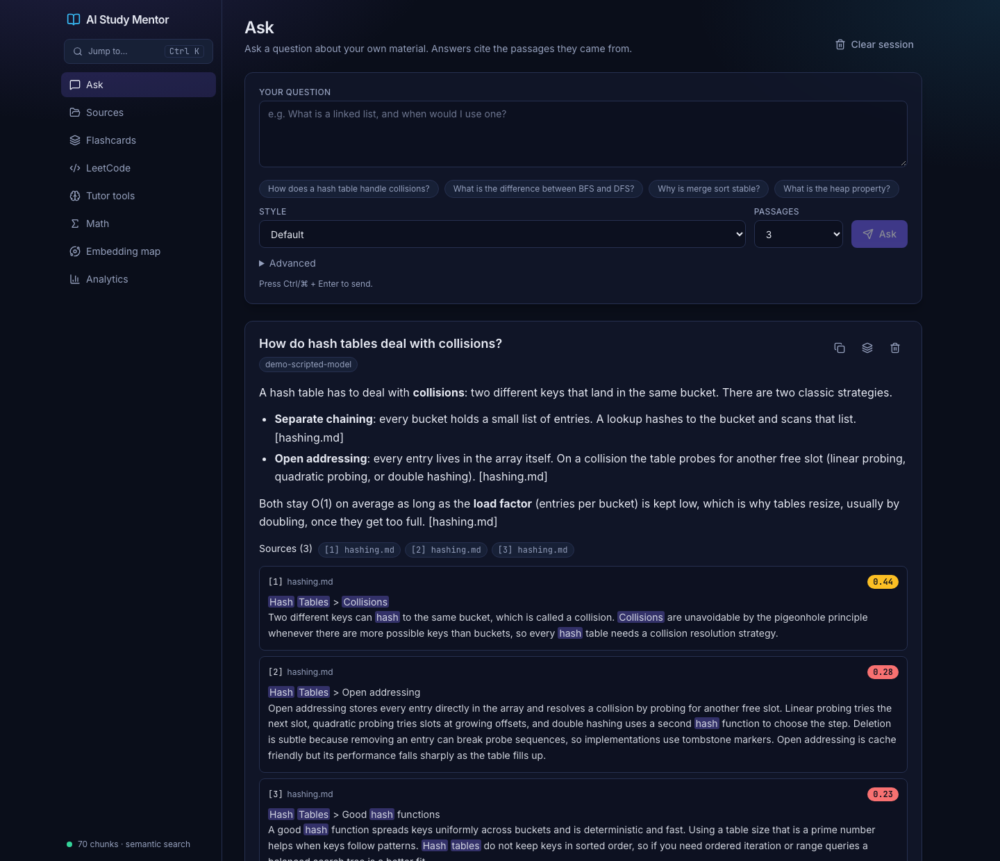
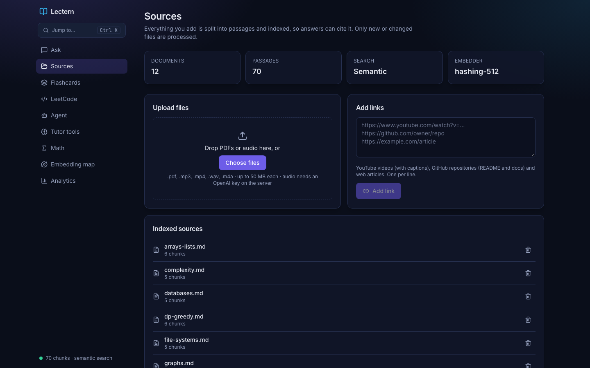
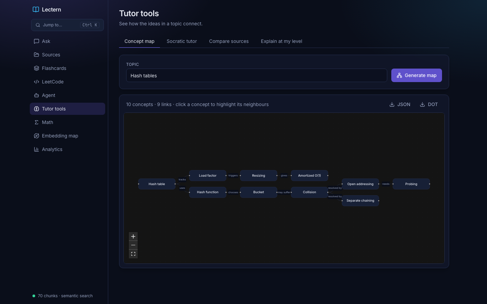
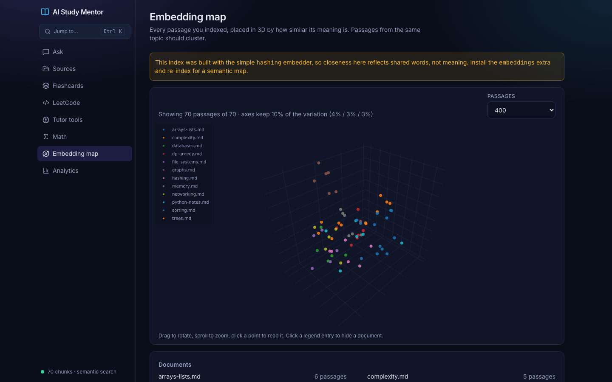
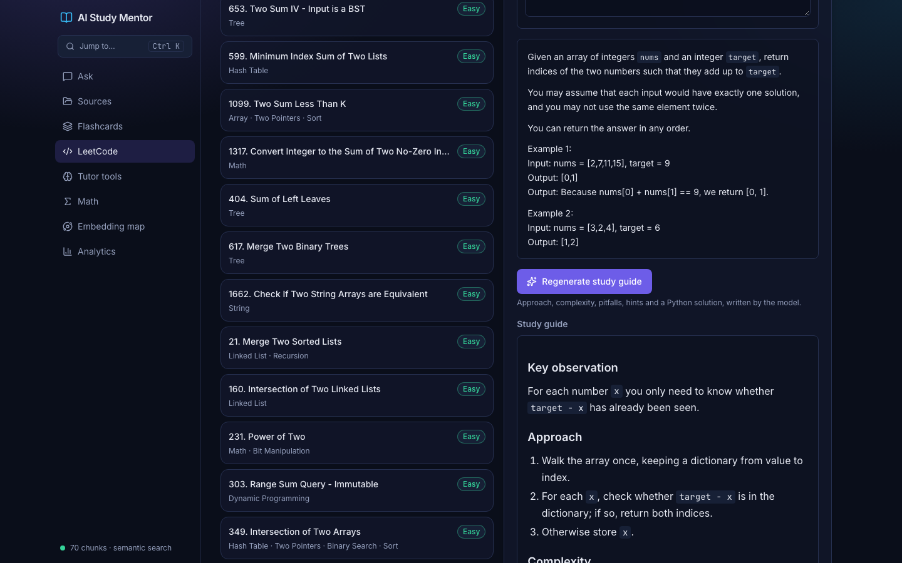
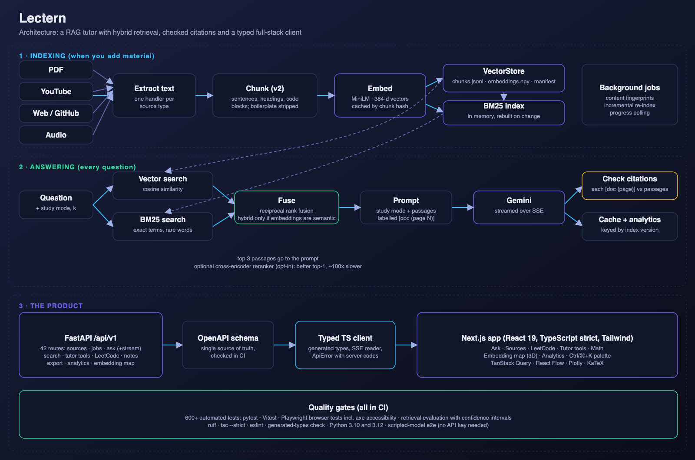
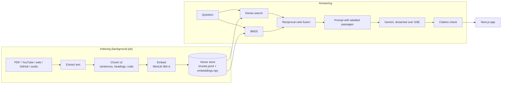
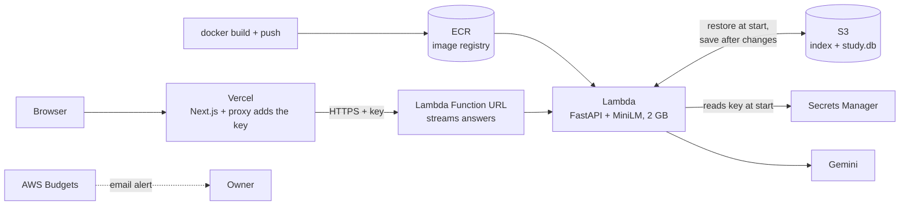

# AI Study Mentor

**A retrieval-augmented tutor for Computer Science study material: ask questions of your own textbooks, lectures and repos, and get answers with citations that are checked against the passages the model actually saw.**

Full stack: Python/FastAPI backend with a hand-built vector store and hybrid search, a TypeScript/Next.js frontend, and an evaluation harness that measures every retrieval decision.

**Live demo: [ai-study-mentor-two.vercel.app](https://ai-study-mentor-two.vercel.app)**: ask questions of three CS textbooks, with streamed cited answers. It is a read-and-ask demo: uploading sources, flashcards, progress and history are switched off because they would be shared between all visitors. It has a daily cap on model calls and sits on Google's free tier, so it can answer "busy, try again" at times. The first question after a quiet period takes up to about 30 seconds while the API wakes up.



> **About the screenshots.** They are captured from `scripts/demo_server.py`, which runs the real API, real chunking, real MiniLM embeddings and real hybrid retrieval over a small committed corpus, but uses a **scripted stand-in for the language model** (no API key). Answer text in the screenshots is therefore not model output. Run the app with a `GEMINI_API_KEY` for real answers.

---

## What it does

- **Ingests** PDFs, YouTube transcripts, web pages, GitHub repos and audio, as background jobs with progress.
- **Answers only from your sources**, streamed token by token, with `[document (page N)]` citations. Each citation is **verified** against the retrieved passages and flagged if the document or page was never retrieved.
- **Retrieves with hybrid search**: embeddings (meaning) + BM25 (exact terms), merged by reciprocal rank fusion. Measured, not assumed.
- **Tutors**: concept maps, a Socratic tutor that gives hints not answers, cross-source synthesis, level-adaptive explanations, symbolic math.
- **LeetCode mentor**: 1,825 searchable problems with AI-written study guides, progress tracking (todo / attempted / solved, with notes) and a study plan built from your weak topics.
- **Flashcards with spaced repetition**: SM-2 scheduling, cards written from your material by the model or saved from any answer, exported to Anki (CSV or `.apkg`).
- **Remembers your work**: Ask history is saved on the server and comes back even if you clear the browser.
- **Shows its work**: retrieved passages with scores, a 3D map of your document embeddings, and an analytics dashboard.

| | |
|---|---|
|  |  |
| Sources: upload, URLs, indexed documents | Concept map (React Flow + dagre) |
|  |  |
| 3D map of the real embeddings (PCA) | LeetCode search and study guide |

More: [Socratic tutor](docs/images/socratic.png) · [Math](docs/images/math.png) · [Analytics](docs/images/analytics.png) · [Command palette](docs/images/command-palette.png) · [Mobile](docs/images/mobile.png)

---

## Results

Retrieval was evaluated on three real CS textbooks (about 4,700 passages, 33 answerable questions). Every change below was measured; intervals are paired-bootstrap 95%.

| Configuration | hit@3 | MRR | ms/query |
|---|---:|---:|---:|
| Original keyword overlap | 64% | 0.58 | 75 |
| BM25 (own implementation) | 82% | 0.71 | 0.3 |
| Dense MiniLM embeddings | 82% | 0.78 | 3 |
| **Default: hybrid + structure-aware chunking** | **94%** | 0.78 | 3.5 |
| Default + cross-encoder reranker (opt-in) | 94% | 0.86 | 337 |

- Default vs dense: **+12 points at hit@3 (95% interval +3 to +24)**, the only change whose interval excluded zero.
- Negative results are reported too: new chunking alone hurts MRR, hybrid with a non-semantic embedder is worse than BM25, chunk size barely matters.
- **Fine-tuning was evaluated and rejected**: the remaining misses are retrieval failures, where the right passage never reaches the model.
- Limits are stated: small sample, one labeller, tuned on the data it measures, retrieval only (answer faithfulness is not measured). See [`eval/README.md`](eval/README.md).

---

## Architecture





How the pieces fit:

| Layer | Technology | Role |
|---|---|---|
| Web app | Next.js 16, React 19, TypeScript (strict), Tailwind v4, TanStack Query | UI, streaming, state |
| Typed client | OpenAPI → `openapi-typescript` + `openapi-fetch`, custom SSE reader | Frontend types generated from the backend |
| API | FastAPI, Pydantic, Uvicorn, Server-Sent Events | 40 operations under `/api/v1` |
| Retrieval | NumPy exact search (FAISS opt-in), BM25, RRF, optional cross-encoder | Hybrid search |
| Embeddings | sentence-transformers `all-MiniLM-L6-v2` (384-d), hashing fallback | Meaning as vectors |
| Generation | Provider interface: Google Gemini (`google-genai`) or any OpenAI-compatible server | Answers, tutor tools, JSON mode |
| Storage | JSONL + NumPy + JSON manifest; SQLite for analytics | No pickle, no server |
| Cloud | AWS Lambda (container), S3, ECR, Secrets Manager, Budgets, Terraform | API hosting, durable state, infrastructure as code |
| Quality | pytest (340), Vitest (84), Vitest, Playwright + axe, GitHub Actions, evaluation harness | CI gates |

Deep dive: [`docs/ARCHITECTURE.md`](docs/ARCHITECTURE.md).

### Engineering highlights

- **Own vector store** with atomic writes, content-hash de-duplication, incremental indexing (SHA-256 fingerprints) and a manifest that refuses to mix embedders.
- **A real debugging story**: a macOS crash traced to FAISS and PyTorch each bundling an OpenMP runtime; resolved by making exact NumPy search the default (about 1 ms at this scale) and FAISS opt-in.
- **Citation verification**: catches invented documents and pages in model output.
- **Safe by design**: sanitized uploads, optional API key, restricted CORS, rate limiting, one error schema with no internal text, math in a sandboxed worker process with a timeout (no `eval`), allow-list HTML sanitizer.
- **Schema as contract**: CI fails if the OpenAPI file or generated TypeScript types are stale.
- **Tested without a paid model**: a scripted model drives end-to-end browser tests with accessibility scans.

---

## API at a glance

All under `/api/v1` except `/health`. Interactive docs at `/docs`. Full detail and examples: [`docs/API.md`](docs/API.md).

| Area | Operations |
|---|---|
| Health and corpus | `GET /health` · `GET /stats` · `GET /documents` · `DELETE /sources?key=` |
| Ingestion | `POST /sources/files` · `POST /sources/urls` · `GET /jobs/{job_id}` |
| Ask and search | `POST /ask` · `POST /ask/stream` (SSE) · `GET /search` · `GET /suggestions` · `GET /models` |
| Tutor tools | `POST /concept-map` · `/socratic` · `/synthesis` · `/adaptive` · `/math` |
| LeetCode | `GET /leetcode/stats` · `/leetcode/search` · `/leetcode/problems/{pid}` · `POST /leetcode/problems/{pid}/explain` |
| Flashcards | `GET` / `POST /cards` · `POST /cards/generate` · `GET /cards/export` · `POST /cards/{id}/review` · `DELETE /cards/{id}` |
| LeetCode progress | `GET /leetcode/progress` · `PUT` / `DELETE /leetcode/progress/{pid}` · `GET /leetcode/plan` |
| History | `GET` / `POST /history` · `DELETE /history` · `DELETE /history/{id}` |
| Notes and export | `POST /notes` · `POST /export` |
| Analytics and viz | `GET` / `DELETE /analytics` · `GET /embeddings/projection` |

Streaming events from `POST /ask/stream`: `meta` (retrieved passages) → `token`* → `done` (model, checked citations, cached) or `error`.

---

## Deployed on AWS

The API runs in the cloud as a **container on AWS Lambda**, with its state in **S3**, infrastructure written as **Terraform**, and a spend alert on the account. The web app is hosted on **Vercel** and reaches the API through a server-side proxy, so the API key never reaches a visitor's browser.



| AWS service | Why it is here |
|---|---|
| **Lambda** (container image) | Runs the API only while a request is handled, so there is no idle server bill. A Function URL gives it public HTTPS and streams answers token by token. |
| **S3** | Container disks are wiped on restart; the search index and the flashcard/progress database are restored from S3 at start and saved back after changes. Private, encrypted, versioned. |
| **ECR** | Holds the Docker image (CPU-only PyTorch, the MiniLM model baked in so there is no download at runtime). |
| **Secrets Manager** | Holds the Gemini API key; it never appears in the image, the repo or Terraform state. |
| **IAM** | One least-privilege role: write logs, use its own bucket prefix, read its own secret. |
| **Budgets** | A monthly spend alert ($15) by email. |
| **Vercel** (not AWS) | Hosts the Next.js app. Its `/api/backend` route forwards calls to the API, adds the key, and only lets read and ask routes through. |
| **API key + daily cap** | Callers must send `X-API-Key`; model calls are capped per day (counted in S3). |
| **Terraform** | The whole setup is one reviewable file (`infra/main.tf`); `terraform destroy` removes it. |

Measured on the live deployment: a cold start takes about 23 s (loading the model and restoring the index), a warm request about 0.13 s, peak memory about 970 MB of 2 GB. The estimated cost is about $1 a month (AWS list prices, not yet checked against a bill).

Honest limits: Lambda can run several copies at once and this account's quota does not allow capping it at one, so overlapping writes to the study database could overwrite each other (fine for one person, not for many). Every API call needs a secret key (stored in Secrets Manager) and the model is capped at a fixed number of calls per day, so a leaked address cannot run up the bill; the address is still not published here because visitors would not have a key. There is no automatic deploy from GitHub yet. Full explanation, including a first attempt on App Runner that this account could not use: [`docs/AWS.md`](docs/AWS.md).

---

## Quick start

Requires Python 3.10+, Node 20+, and a [Gemini API key](https://aistudio.google.com/) (or an OpenAI-compatible endpoint, see `LLM_PROVIDER`) for generated answers (retrieval, LeetCode, math and the embedding map work without one).

```bash
git clone https://github.com/moh0405/AI-study-mentor-.git && cd AI-study-mentor-
python -m venv .venv && source .venv/bin/activate
pip install -e ".[all,dev]"
cp .env.example .env            # set GEMINI_API_KEY

uvicorn backend.api:app --reload --port 8000     # API  → http://localhost:8000/docs

# in a second terminal
npm install
cp apps/web/.env.example apps/web/.env.local
npm run web:dev                                   # web  → http://localhost:3000
```

No key and just want to look around? `python scripts/demo_server.py` runs the real pipeline over the committed sample corpus with a scripted model.

Tests: `make check` (Python), `npm run web:test`, and `cd apps/web && npx playwright test` (browser, no key needed). Evaluation: `python -m eval.run`.

Everything else (configuration, CLI tools, data directory, troubleshooting): [`docs/REFERENCE.md`](docs/REFERENCE.md).

---

## Learn how it works

This project was built to be understood. The docs teach each technology from first principles, using real numbers from this repo.

- **[Docs index](docs/README.md)**: reading order
- **[AWS deployment](docs/AWS.md)**: what runs in the cloud, why, what it costs, how to operate it
- **[Phase by phase](docs/phases/README.md)**: how the project was built and what each stage taught
- **Concepts**: [RAG](docs/concepts/01-rag.md) · [Embeddings](docs/concepts/02-embeddings.md) · [Vector databases](docs/concepts/03-vector-databases.md) · [Search and ranking](docs/concepts/04-search-and-ranking.md) · [Chunking](docs/concepts/05-chunking.md) · [LLMs and prompting](docs/concepts/06-llms-and-prompting.md) · [Backend stack](docs/concepts/07-backend-stack.md) · [Evaluation](docs/concepts/08-evaluation.md) · [Frontend stack](docs/concepts/09-frontend-stack.md) · [Testing and CI](docs/concepts/10-testing-and-ci.md) · [Glossary](docs/concepts/11-glossary.md) · [Spaced repetition and LLM providers](docs/concepts/12-study-features.md)

## Repository layout

```
backend/         Python: API (api/), retrieval, indexing, LLM client, tutor tools
apps/web/        Next.js app (app/, features/, components/, lib/, e2e/)
packages/api-client/   OpenAPI schema + generated TypeScript client + SSE reader
eval/            retrieval evaluation: corpora, questions, metrics, committed reports
tests/           pytest suite, scripted model, e2e API server
scripts/         OpenAPI export, preprocessing, demo server
infra/           Terraform for the AWS deployment
Dockerfile       the API image (also what Lambda runs)
docs/            architecture, concepts, phases, API, plan
```

## Status and honest limits

Phases 0 to 5 are done (hygiene, retrieval core, API, frontend, answer quality, study tools). Phase 6 (deployment) is partly done: the API is live on AWS, while the hosted web app, automatic deploys and extra hardening are next. Phase 7 is release polish; see [`docs/PLAN.md`](docs/PLAN.md).

- The AWS deployment is a single-user demo design: study data is a SQLite file synced through S3, not a database that several users can write to at once.
- Single process and single user: in-memory jobs and rate limits, and flashcards, progress and history live in one SQLite file with no accounts (a deliberate portfolio-scope decision).
- Exact search is right up to roughly 100k passages; beyond that you would want an approximate index.
- Evaluation measures retrieval, not whether a generated claim is faithful to its source; citation checks catch invented sources only.
- The demo screenshots use a scripted model, as noted above.

## License

MIT, see [LICENSE](LICENSE).
