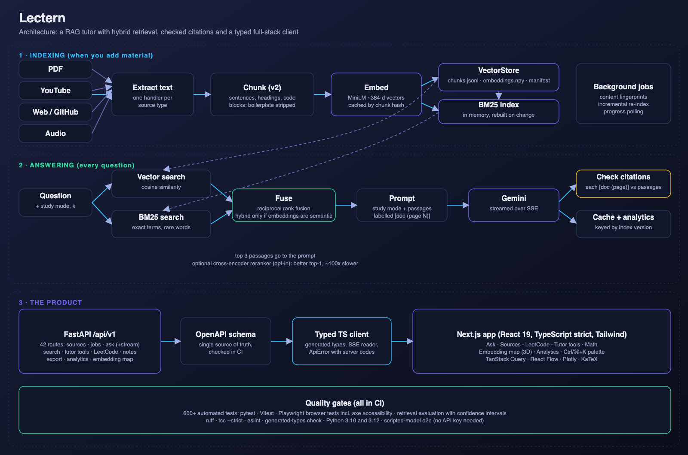

# Architecture

This document explains how AI Study Mentor is put together: what each part does, how data moves through it, why it was built that way, and what happens when something is missing or breaks. Read it after the README and before the code.



## 1. The system in one paragraph

You give the app study material (PDFs, YouTube lectures, web pages, GitHub repos, audio). A **background job** extracts the text, cuts it into passages, turns each passage into a vector of numbers (an *embedding*), and saves everything to disk. When you ask a question, the app searches the passages **two ways at once**, by meaning (vectors) and by words (BM25), merges the two rankings, and hands the best three passages to a language model (Gemini) with an instruction to answer *only* from them and to cite them. The answer streams to the browser; afterwards each citation is **checked** against the passages the model was actually given. A Next.js web app talks to a FastAPI backend through a TypeScript client that is *generated* from the backend's OpenAPI schema, so the two cannot drift apart.

Everything is one codebase in three parts:

| Part | Where | Language | Job |
|---|---|---|---|
| Backend | `backend/` | Python | indexing, retrieval, LLM calls, the HTTP API |
| Web app | `apps/web/` | TypeScript (React/Next.js) | the user interface |
| API client | `packages/api-client/` | TypeScript | types and helpers generated from the API's schema |

Plus `eval/` (retrieval evaluation), `tests/` (Python tests), `scripts/` (CLI tools, demo server) and `docs/`.

## 2. Components

### Backend modules (`backend/`)

| Module | Responsibility | Key idea |
|---|---|---|
| `sources/` (`youtube`, `web`, `github`, `audio`) + `document_processor.py` | Turn an input (file or URL) into a list of **chunk dicts** | Every source returns the same shape, so the rest of the system does not care where text came from |
| `chunking.py` | Cut text into passages | Sentences and headings, not fixed windows; strips page headers and licence boilerplate |
| `embeddings.py` | Text to vectors | MiniLM (semantic) or a dependency-free hashing fallback; both normalized |
| `vector_store.py` | Save and search vectors | `chunks.jsonl` + `embeddings.npy` + `manifest.json`; add, remove, de-duplicate, exact search |
| `lexical.py` | Keyword search | BM25 implemented from scratch, plus reciprocal rank fusion |
| `rerank.py` | Optional re-ordering | A cross-encoder that reads query and passage together |
| `indexer.py` | Build and update the index | Incremental: content fingerprints, skip unchanged files, re-chunk when the chunker changes |
| `rag_engine.py` | The orchestrator | `retrieve_context`, prompt building, calls the model, suggestions, notes |
| `llm_config.py` | Talk to Gemini | Model resolution, retries, streaming, JSON mode |
| `citations.py` | Verify an answer's citations | Checks each `[doc (page N)]` against the retrieved passages |
| `advanced_ai.py` | Tutor tools | Concept map, Socratic tutor, source synthesis, adaptive explanation |
| `safe_math.py` | Math without `eval` | Whitelist parser in a sandboxed worker process with a timeout |
| `leetcode_handler.py` | Problem bank | Load, normalize, search and explain problems |
| `projection.py` | PCA to 3D | Powers the embedding map |
| `export_utils.py` | Markdown to PDF/HTML | HTML passes through an allow-list sanitizer |
| `api/` | The HTTP API | FastAPI app, routers, error format, jobs, cache, analytics store |

### Web app (`apps/web/`)

| Folder | Contents |
|---|---|
| `app/` | One tiny file per route; each renders a view from `features/` |
| `features/` | One folder per feature: `ask`, `sources`, `leetcode`, `study` (flashcards), `tutor`, `math`, `visualize`, `analytics` |
| `components/` | The shell (sidebar, status), command palette, Markdown renderer, UI primitives |
| `lib/` | API helpers, URL-state hook, formatting, CSV and download helpers |
| `e2e/`, `screenshots/` | Playwright browser tests; the README screenshot capture |

## 3. Data flow A: indexing

Triggered by `POST /api/v1/sources/files` or `/sources/urls` (the web app's Sources page), or by `python scripts/preprocess_all_documents.py`.

```mermaid
sequenceDiagram
    participant UI as Web app
    participant API as FastAPI
    participant Job as Job manager (1 worker)
    participant Idx as Indexer
    participant Store as VectorStore (disk)
    UI->>API: POST /sources/files (PDF)
    API->>API: validate type, %PDF- signature, size; sanitize file name; save to disk
    API->>Job: submit(index job)
    API-->>UI: 202 + job_id
    loop every 0.8 s
        UI->>API: GET /jobs/{id}
        API-->>UI: status + progress messages
    end
    Job->>Idx: index_inputs([file])
    Idx->>Idx: fingerprint = SHA-256 of the file
    alt unchanged and chunked by the current chunker
        Idx-->>Job: skipped
    else new or changed
        Idx->>Idx: extract text -> chunk (v2) -> hash each chunk
        Idx->>Idx: drop chunks already stored (de-duplicate)
        Idx->>Idx: embed only the new chunks (batches of 256)
        Idx->>Store: add chunks + vectors, record fingerprint and chunker version
        Idx->>Store: save (atomic: write temp file, then rename)
    end
    Job-->>API: report {indexed, skipped, failed, chunks_added}
```

Things worth noticing:

- **Incremental.** A file's fingerprint is the SHA-256 of its *content*, so renaming or touching a file does not re-index it, and editing it does. Each chunk is also hashed, so identical text is never embedded or stored twice. Re-running the indexer on an unchanged corpus takes about half a second.
- **Safe on failure.** The old version of a source is removed only *after* the new text was extracted successfully, so a failed parse leaves previously indexed chunks untouched.
- **Chunker versioning.** Each source records which chunker made it. When the chunking algorithm improves (as it did in Phase 4), the next index run re-chunks old sources automatically.
- **One worker.** Indexing mutates one shared store, so jobs run one at a time. Job records live in memory (the index itself is on disk).

## 4. Data flow B: answering a question

```mermaid
sequenceDiagram
    participant UI as Ask page
    participant API as POST /ask/stream
    participant Eng as RAGEngine
    participant LLM as Gemini
    UI->>API: {question, k, mode}
    API->>API: cache lookup (question, mode, k, model, temperature, index version)
    alt cache hit
        API-->>UI: meta, token..., done (cached: true)
    else miss
        API->>Eng: retrieve_context(question, k)
        Eng->>Eng: embed question; vector search top 50; BM25 top 50
        Eng->>Eng: reciprocal rank fusion -> top k; attach cosine score to each
        API-->>UI: event "meta" (the passages)
        API->>LLM: prompt (mode template + passages labelled [doc (page N)])
        loop streamed
            LLM-->>API: text fragment
            API-->>UI: event "token"
        end
        API->>API: check_answer(text, passages)
        API->>API: store in cache, record analytics
        API-->>UI: event "done" {model, citations, unverified_citations, uncited}
    end
```

- The **passages arrive first** (`meta`), before the model says anything. If there is no API key the user still sees what was retrieved.
- Errors are **events**, not HTTP failures, once streaming has started (`error` with a code such as `llm_unavailable`).
- The **cache key includes the index version**, so adding or removing a source invalidates cached answers. Failures and empty answers are never cached.

## 5. Where the data lives

```
data/
  uploaded_files/        your PDFs and audio (gitignored) + sources.txt (URLs)
  vector_store/          the index (gitignored, rebuildable)
    manifest.json        store version, embedder name/dimension, per-source fingerprint + chunker version
    chunks.jsonl         one JSON object per chunk: text, doc, page, end_page, hash, source_key, ...
    embeddings.npy       float32 matrix; row i belongs to chunk i; every row has length 1
    index.faiss          only when VECTOR_BACKEND=faiss
  analytics.db           SQLite: one row per asked question
  study.db               SQLite: flashcards (SM-2 state), LeetCode progress, Ask history
  leetcode/
    normalized_problems.jsonl   1,825 problems (committed)
    kaggle/                     the raw CSVs it was built from (committed)
```

There is deliberately **no pickle** (loading a pickle runs code, so an untrusted index file would be dangerous) and no external database. Files are written atomically (temp file, then rename), so a crash mid-save cannot leave a half-written index.

## 6. Concurrency model

| Thing | How it runs | Why |
|---|---|---|
| HTTP endpoints | FastAPI runs plain `def` endpoints in a thread pool; `async def` ones offload blocking work with `run_in_threadpool` | One slow request must not freeze the server |
| Indexing | A single-worker `ThreadPoolExecutor` (job manager) | The store is shared and mutated |
| The store | One shared `RAGEngine` per process; mutations hold a lock; BM25 rebuilds when `store.revision` changes | Safe reads while indexing |
| Math | A *separate process* (spawned) with a 5 s timeout; killed and replaced on timeout | Untrusted input must not be able to hang the server |
| Streaming | A generator the framework iterates in a thread | Tokens reach the client as produced |

A subtle consequence: the math worker is created with `spawn`, which **re-imports the script that started the server**. Any launcher script must therefore keep side effects under `if __name__ == "__main__":` (the demo server does; this was a real bug found while making screenshots).

## 7. API design

- **Versioned** under `/api/v1`; `/health` is outside it.
- **One error shape** for every failure (HTTP, validation, unexpected): `{"error": {"code", "message", "details?"}}`. Internal exception text is never returned.
- **Safety rails:** per-IP rate limit, optional `X-API-Key`, CORS limited to configured origins, upload type/signature/size/count limits and sanitized file names.
- **The schema is the contract.** `scripts/export_openapi.py` writes `packages/api-client/openapi.json`; `openapi-typescript` generates types from it; CI fails if either is stale. The frontend never hand-writes request or response types.

Full route list: see the README or [API reference](API.md).

## 8. Frontend architecture

- **Routing:** Next.js App Router. Each `app/<route>/page.tsx` is a few lines that render a client view from `features/`.
- **Server state** (anything that lives on the server: documents, stats, jobs, analytics) goes through **TanStack Query**: caching, de-duplication, retries (not on 4xx), polling for jobs.
- **Streaming** is a small state machine: a pure *reducer* (`features/ask/session.ts`) turns events (`start`, `meta`, `token`, `done`, `error`, `stop`) into state, and a hook (`use-ask-session.ts`) feeds it from the SSE stream. Because the reducer is pure it is easy to unit-test.
- **URL as state** for filters and selections (LeetCode, tutor tabs), so a view can be shared and survives a reload.
- **Persistence:** finished Ask turns are saved on the server (`/history`) and restored in a fresh browser; a half-streamed answer is never saved. In the public demo, where the shared database is off, LeetCode progress and flashcards are kept in the visitor's own `localStorage` instead (`lib/local-progress.ts`, `lib/local-cards.ts`; the card scheduler mirrors `backend/srs.py`).
- **Markdown from the model is untrusted:** `react-markdown` does not render raw HTML, and exported HTML goes through a sanitizer on the server.

## 9. Quality architecture

| Layer | Tool | What it proves |
|---|---|---|
| Unit | pytest | pure logic: chunking, BM25, fusion, citations, cache, stemmer, safe math |
| Component/API | pytest + FastAPI `TestClient`, Vitest + Testing Library | endpoints and components, with a fake model |
| End to end | Playwright | the real API and real browser together, with a scripted model (no key needed) |
| Accessibility | axe-core inside Playwright | WCAG A/AA on every page |
| Retrieval quality | `eval/` | hit@k, MRR and confidence intervals on two corpora |
| Static | ruff, `tsc --strict`, eslint, generated-types check | type and style correctness, schema in sync |
| CI | GitHub Actions: backend (Python 3.10, 3.12), frontend, e2e | all of the above on every push |

## 10. Key design decisions

| Decision | Alternatives | Why this one |
|---|---|---|
| Store = `chunks.jsonl` + `embeddings.npy` + manifest | pickle; a vector database; SQLite | Human-readable, safe to load, rebuildable, no server to run; plenty fast at this size |
| **Exact NumPy search by default**, FAISS opt-in | FAISS always | On macOS, FAISS and PyTorch each bundle an OpenMP runtime and the process aborts when both run; exact search over ~5,000 vectors takes about a millisecond anyway |
| BM25 written from scratch (~100 lines) | `rank_bm25` | No dependency, and I could make scores comparable across queries (needed for "no good match" signals) |
| Hybrid search only with a *semantic* embedder | always hybrid | Measured: fusing in the non-semantic hashing embedder is worse than BM25 alone |
| Server-Sent Events over POST via `fetch` | WebSocket; `EventSource` | One-way stream, plain HTTP, works through proxies; `EventSource` cannot POST, so a small reader parses the stream |
| Generated TypeScript client | hand-written types | The schema is the single source of truth; CI catches drift |
| Scripted model for end-to-end tests | calling Gemini in tests | Free, deterministic, no secrets in CI |
| Check citations after generation | trust the model | A confident wrong citation is worse than none |
| Answer cache keyed by index version | time-based expiry | Never serves an answer about material that has since changed |
| Whitelist math parser in a worker process | `eval`, `sympify` | Math input is untrusted text |
| Page-level relevance for PDF evaluation | phrase-in-chunk only | Phrase labels depended on chunk boundaries (a measured problem) |

## 11. What happens when something is missing

| Missing or broken | Behaviour |
|---|---|
| No `GEMINI_API_KEY` | Ask streams the passages, then an `llm_unavailable` error that the UI explains; retrieval, LeetCode, math, embedding map and analytics keep working |
| `sentence-transformers` not installed | Falls back to the hashing embedder; `auto` retrieval uses BM25 alone |
| An index built with MiniLM, but MiniLM cannot load | Keyword (BM25) retrieval; never mixes incompatible vectors |
| FAISS not installed, or torch is loaded | NumPy exact search (always correct) |
| Model returns an empty or blocked answer | An error is reported; nothing is cached |
| A PDF fails to parse | That source is reported as failed; its previous chunks stay |
| Reranker cannot load | Keeps the first-stage order, logs a warning, never fails the search |
| Two requests ask the same thing | The second is served from the cache (unless `no_cache`) |

## 12. Limits and honest scale

- Exact search compares the query with every vector: fine up to roughly 100,000 passages on one machine; beyond that you would want an approximate index (FAISS IVF/HNSW, or a vector database).
- One process, in-memory jobs and rate limits: right for a portfolio deployment, not for many users. Section 13 describes the deployment; a real multi-user system would need auth, a shared job queue and a database.
- Retrieval quality is measured on 33 and 44 questions, so differences smaller than about 10 points are noise (see `eval/README.md`).
- Answer *faithfulness* (does the model's claim match its source?) is not measured, only whether citations point at real retrieved passages.

## 13. Deployment

```
Browser -> Vercel (Next.js) -> /api/backend/* proxy (adds X-API-Key) -> Lambda Function URL -> FastAPI container
                                                                             |-> S3 (index + study.db, restored at start, saved after changes)
                                                                             |-> Secrets Manager (Gemini key, API key)
                                                                             `-> Gemini
```

- **API:** the same Docker image runs on AWS Lambda (CPU PyTorch, MiniLM baked in). State lives in S3 because a container's disk is wiped on restart. Infrastructure is Terraform (`infra/`); see [AWS.md](AWS.md) for costs and measurements.
- **Web app:** Vercel. The browser never calls the API directly; `apps/web/lib/backend-proxy.ts` forwards allowed requests and adds the key, so the key never reaches a visitor.
- **Public-demo rules:** the proxy allows reading and asking only. Routes that write to, or reveal, the shared study database answer `403 disabled_in_demo`, and the web app does not send them (`lib/demo.tsx`). Flashcards and LeetCode progress still work for each visitor through browser storage; history, analytics and the personalised study plan stay off.
- **Delivery:** CI (GitHub Actions) tests every push, including a real-browser run in demo mode (`apps/web/playwright.demo.config.ts`). An optional OIDC deploy workflow (`.github/workflows/deploy.yml`, off until enabled in `infra/ci.tf`) updates the Lambda without stored AWS keys.
- **Known limit:** Lambda may run several copies, each with its own disk, so concurrent writes to `study.db` could overwrite each other. Fine for one person, which is why the demo keeps visitor data in the browser.
